# Lanceur 308 — dossier de reprise (version 0.8)

> **À lire en entier avant de toucher à quoi que ce soit.**
> Ce dossier permet à une IA (ou à un développeur) de reprendre le projet **exactement là où il en est** au 6 novembre 2026.
> L'ancien README (version 0.4) est conservé dans `diagnostic/README_ancien_v0.4.md` pour l'historique.
>
> **Non publiés dans ce dépôt** (voir `.gitignore`) : les modèles 3D `.glb` et l'APK compilée (ils contiennent
> la plaque d'immatriculation, et la licence du modèle d'origine est à vérifier), `modele-3d/plaque.png`, et
> `fyt-extraits/` (code décompilé des applis FYT, propriété du fabricant). Pour reconstruire le modèle, voir §5.

## Aperçu

La 308 en 3D telle que l'appli l'affiche : accueil en 3/4 avant, ouvrants animés d'après le CAN, phares et feux
pilotés par l'appli, plongée à la place du conducteur dans l'onglet Entretien.
*Rendus du modèle `car.glb` de l'appli (three.js, plaque factice « AB-123-CD ») ; captures de chaque onglet ci-dessous.*

| Accueil (3/4 avant, phares) | Ouvrants ouverts |
|---|---|
| 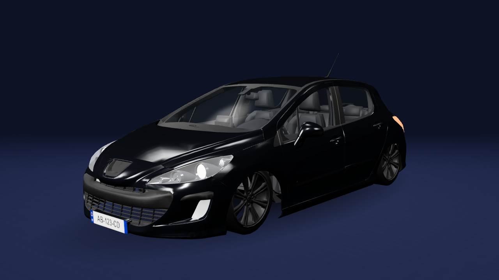 | 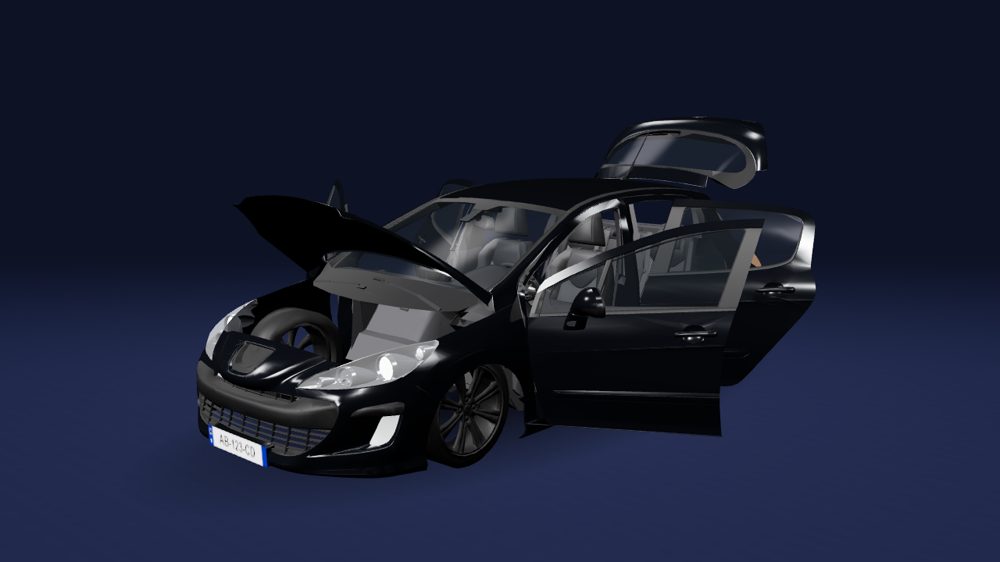 |
| **3/4 arrière, feux allumés** | **Profil** |
| 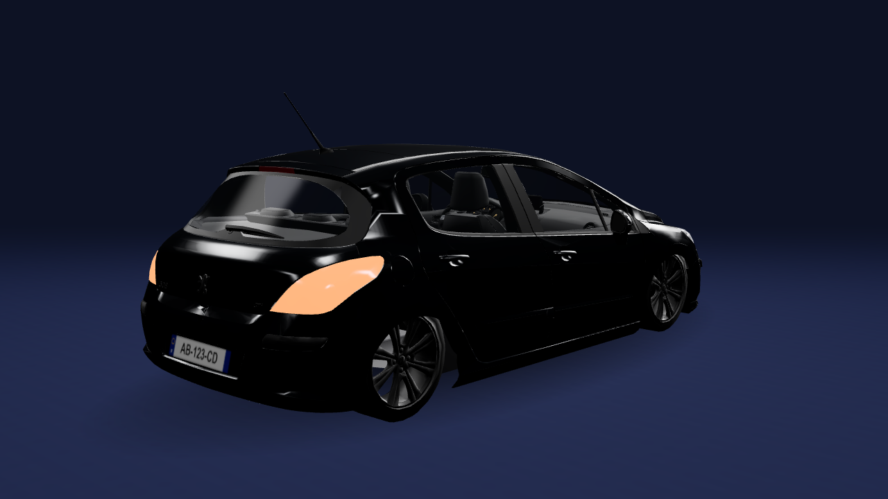 | 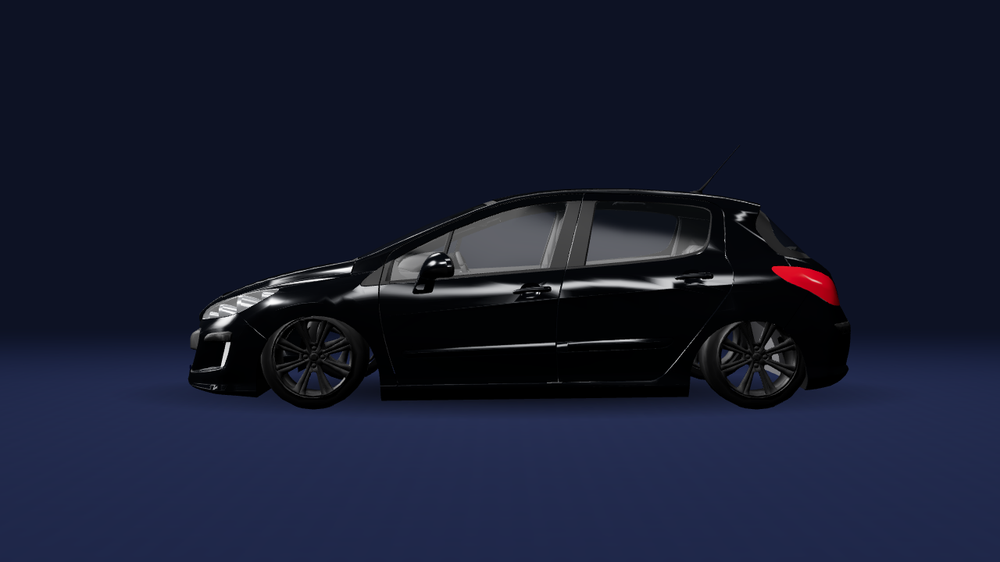 |
| **Vue conducteur (onglet Entretien)** | |
| 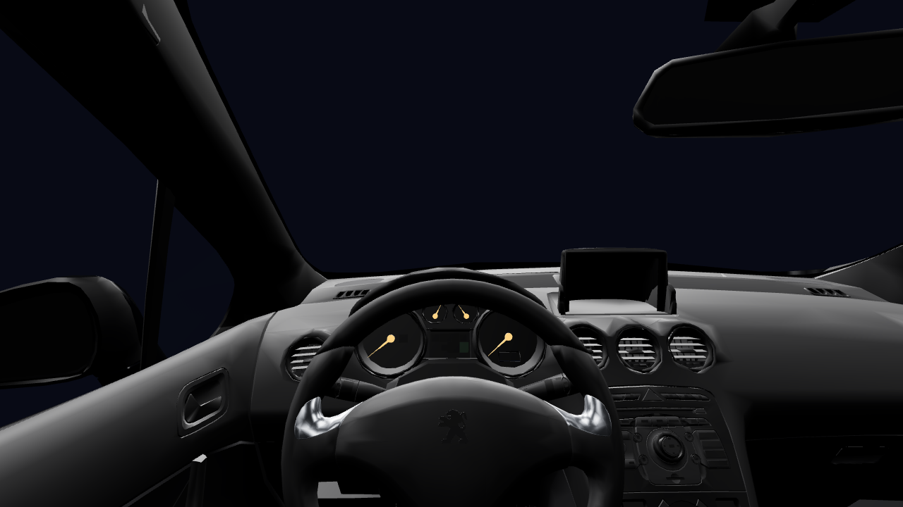 | |

### Les onglets de l'appli (v0.9, Batterie et Trajets en v0.10)

Captures prises le 8 novembre 2026 dans l'émulateur Android (écran 1024 × 600 comme l'autoradio), en **mode démo**
(données simulées). L'émulateur ne sait pas afficher la 3D (Filament) : sur ces captures, la voiture est la vue
de dessus en 2D, celle que l'appli affiche quand la 3D n'est pas disponible. Sur l'autoradio, c'est la 3D ci-dessus.

| Accueil | Véhicule — État |
|---|---|
| 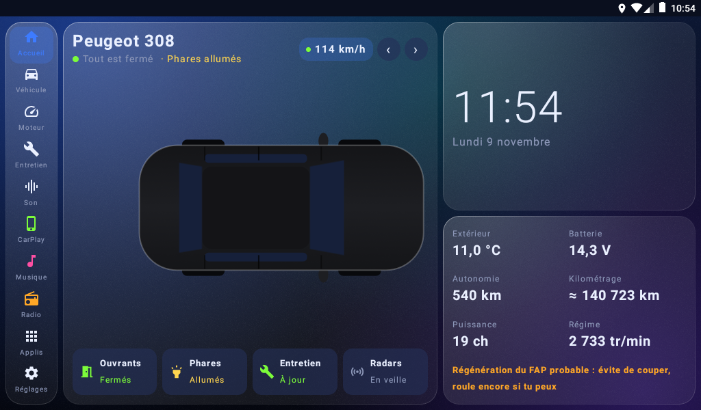 | 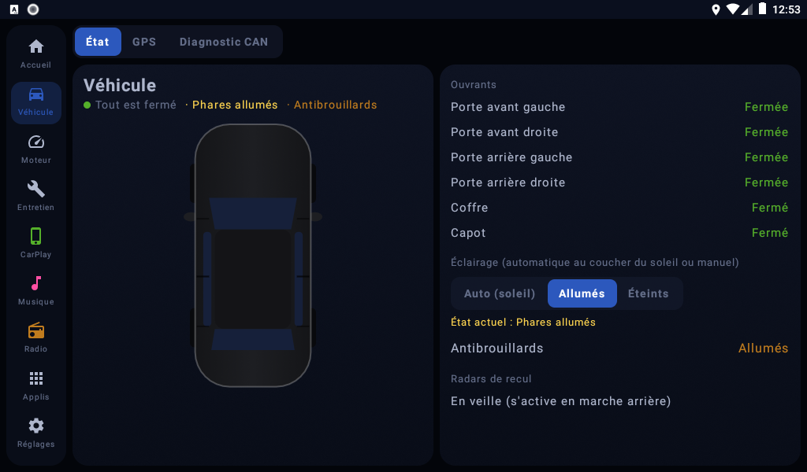 |
| **Véhicule — GPS** | **Véhicule — Diagnostic CAN** |
| 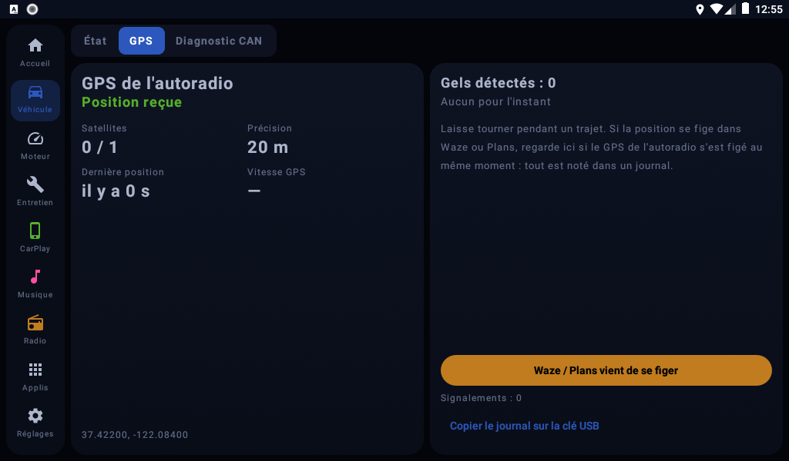 | 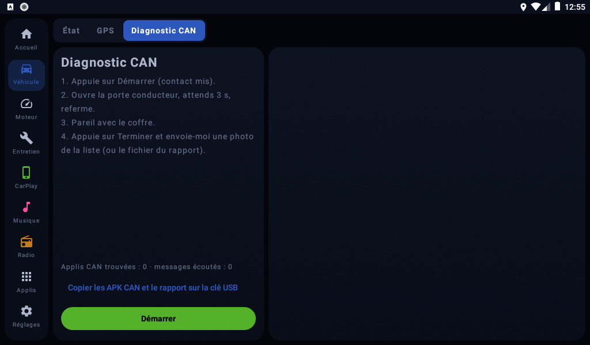 |
| **Moteur — Puissance** | **Moteur — Diagnostic** |
| 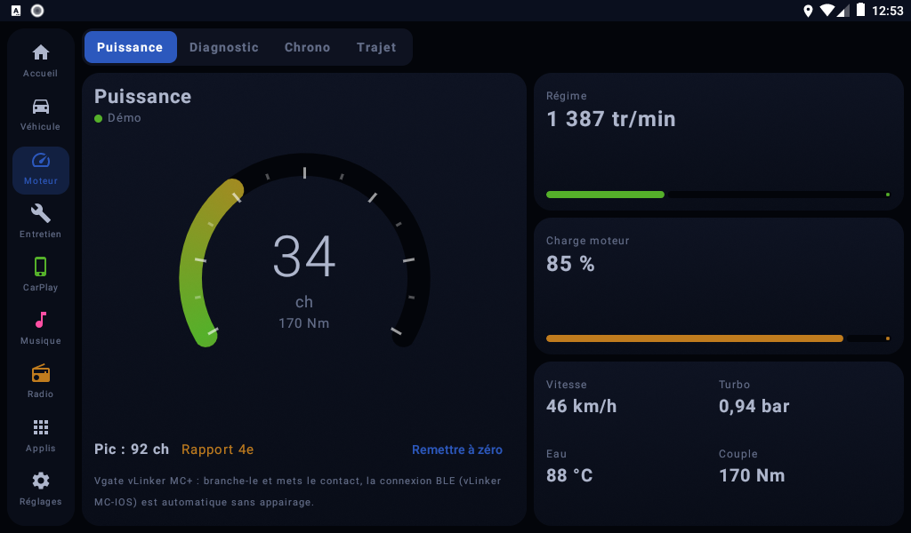 | 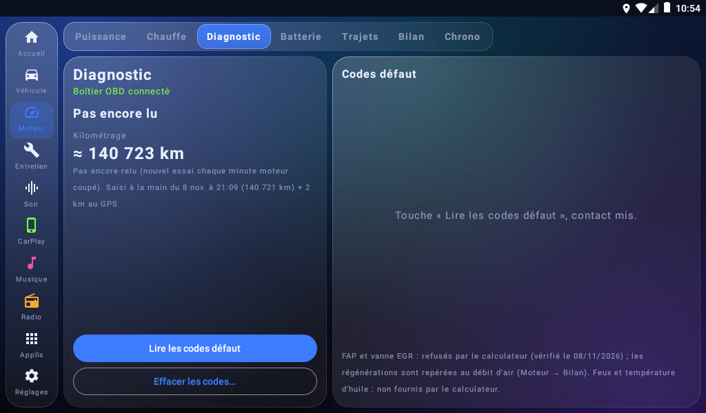 |
| **Moteur — Batterie (v0.10)** | **Moteur — Trajets (v0.10)** |
| 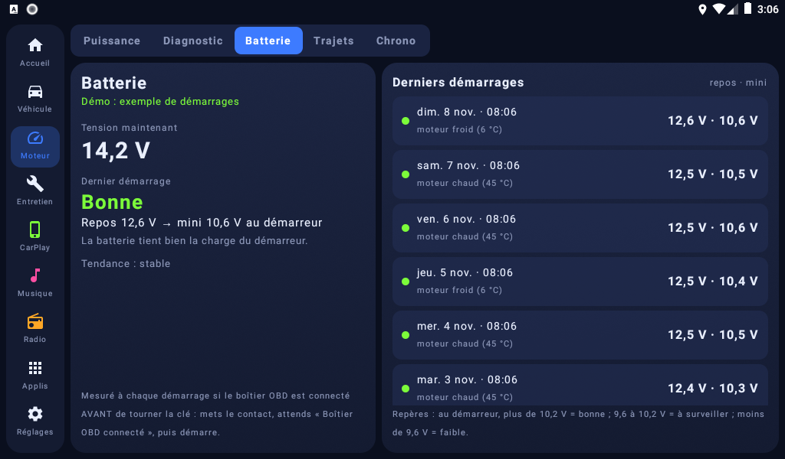 | 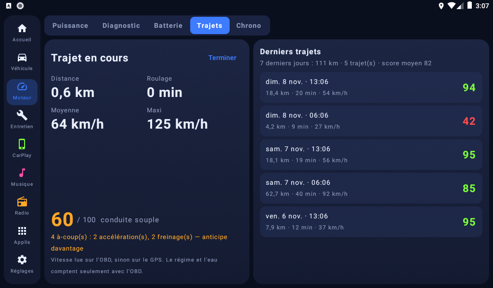 |
| **Moteur — Chrono** | |
| 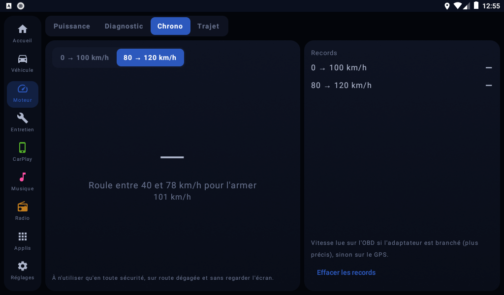 | |
| **Entretien** | **Entretien — Pleins** |
| 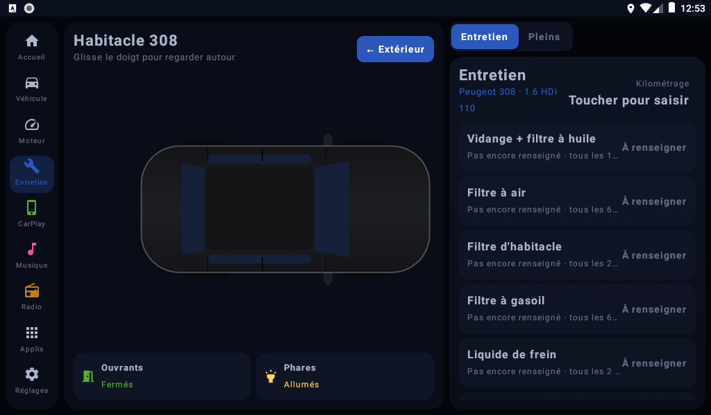 | 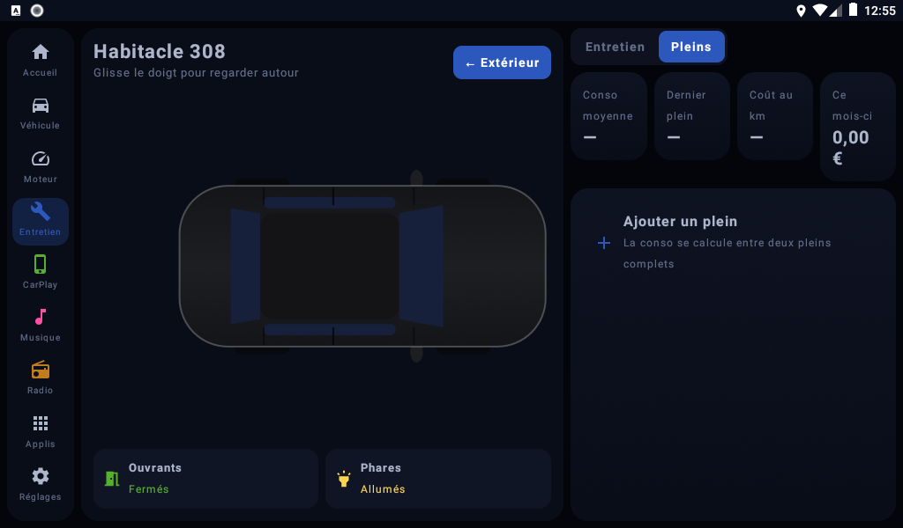 |
| **Réglages** | **Panneau performances à côté de CarPlay** |
| 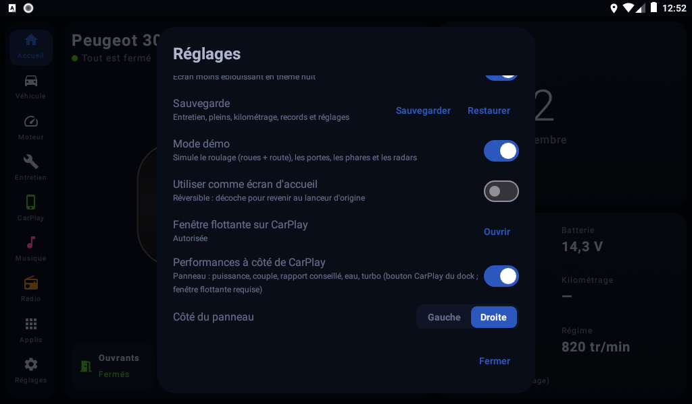 | 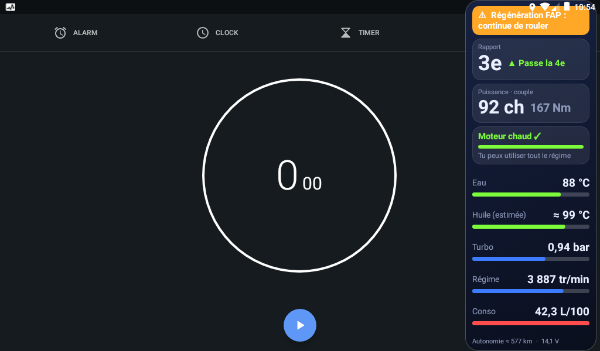 |

**Nouveau en v0.16 : optimisation de l'autoradio** (Réglages → Optimiser l'autoradio ; `optim/Optim.kt`,
`ui/OptimDialog.kt`). Android 8 sans root ni ADB : seulement ce qu'une appli normale peut faire, le reste guidé.
- **Mode CarPlay** : pendant CarPlay, boucle OBD ralentie (pause de 300 ms par tour moteur tournant ; jamais moteur
  coupé, pour le démarreur) et panneau redessiné 2 fois/s au plus (une nouvelle alerte passe tout de suite). But :
  laisser la puce Bluetooth / Wi-Fi 2,4 GHz et le processeur au CarPlay sans fil.
- **Mémoire** : `killBackgroundProcesses` sur les applis en arrière-plan (jamais : com.syu / com.fyt, système vital,
  CarPlay / musique / radio choisis, clavier, Lanceur ; Android épargne aussi ce qui est visible ou joue). Bouton +
  automatique à l'ouverture de CarPlay (10 min mini entre deux).
- **Réglages guidés** avec état relu : animations 0,5×, recherche Wi-Fi / Bluetooth permanente, mises à jour auto du
  Play Store, veille / démarrage rapide FYT (réglages d'usine).
- **Applis pas ouvertes depuis 30 jours** (accès aux données d'utilisation) → page Android pour les désactiver.

**Nouveau en v0.15 : onglet Son** (dock → Son ; code dans `sound/` et `ui/SoundScreen.kt`) :
- **Alignement temporel** : distances oreille → haut-parleur (tweeters sous le pare-brise, arrière) → retard de
  chaque voie ((d_max − d) / 34,3 cm/ms) et baisse de niveau (20·log10(d / d_max)), à recopier dans le DSP.
- **Tests** : son pur 1 kHz et 60 Hz, balayage, par côté ; **polarité** A (en phase) / B (droite inversée).
- **Mesure au micro du PC** (`outils/son/mesure_son.bat`, fiche `outils/son/REGLAGE_SON.md`) : bruit rose → écart à
  une courbe « voiture » par tiers d'octave et réglages d'égaliseur 10 bandes (+ graphique SVG) ; clics gauche puis
  droite à 500 ms exactes → décalage restant ; montée en volume d'un son pur 400 Hz → distorsion par palier et volume
  maximum sans saturer l'ampli. Analyse testée sur signaux synthétiques (`test_mesure_son.py`).
- **Volume selon la vitesse** (paliers 50 / 80 / 110 km/h, intensité réglable, le réglage à la main reste la base) et
  **annonces vocales** (turbo refroidi, régénération du FAP, réserve, surchauffe, batterie ; musique baissée).
- **DSP de l'autoradio** : pas encore piloté (commandes inconnues). Bouton qui copie seulement les APK des applis son
  du système sur la clé pour les étudier (`QUERY_ALL_PACKAGES` ajoutée pour les trouver).

**Nouveau en v0.14** :
- **Régénérations du FAP** (`vehicle/FapRegen.kt`) : l'EDC16C34 refuse de donner le FAP aux lectures autorisées
  (services 21, 22 et 1A, séance du 08/11/2026). Pendant une régénération il ferme la vanne EGR : le débitmètre
  (PID 10, désormais lu ≈ 1 fois par seconde) voit alors bien plus d'air frais. Le Lanceur apprend le débit normal
  moteur chaud par case régime × charge, puis signale une régénération probable quand le débit reste ≥ 25 % au-dessus
  pendant 2 min (charge 8-69 %, 750-3 250 tr/min). Moins de 4 min : ignoré ; moteur coupé pendant : « interrompue ».
  Affichage : accueil, panneau CarPlay (« continue de rouler » / « évite de couper »), Moteur → Bilan (dernière,
  intervalle moyen), bandeau au début, notification si coupée, `regenerations-fap.csv` à l'export, journal OBD
  (débit mesuré et attendu, pour vérifier). Une régénération complète remet à zéro le conseil voie rapide.

**Nouveau en v0.13.1** :
- **Autonomie estimée** (`drive/Insights.kt`, `FuelRange`) : réservoir de 60 L au dernier plein complet, moins les
  km parcourus × la conso (mesurée entre les pleins, sinon estimée, sinon 6 L/100), plus les pleins partiels ;
  donnée jusqu'au témoin de réserve (≈ 6 L). Affichée sur l'accueil, dans Pleins et dans le panneau CarPlay ;
  bandeau sous 50 km.
- **Refroidissement du turbo** (`vehicle/TurboCool.kt`) : secondes de ralenti conseillées avant de couper, qui
  montent pendant l'effort (jusqu'à 60 s, ≈ 5 min de voie rapide) et descendent en roulant doucement ou au ralenti.
  À l'arrêt : « Turbo chaud : attends N s » puis « Turbo refroidi ✓ » (accueil et panneau CarPlay) ; coupure
  moteur turbo chaud notée dans le journal OBD.

**Nouveau en v0.13** :
- **Journal OBD** (`vehicle/ObdLog.kt`) : connexions, chaque essai de lecture du kilométrage avec la réponse brute,
  démarrages (chute saisie ou non), tensions ; 14 jours gardés, copiés sur la clé (dossier `journal/`).
- **Panneau CarPlay** : taille Auto (complet pendant la chauffe ou en cas d'alerte, pastille une fois chaud),
  alertes (surchauffe, charge batterie anormale, FAP à nettoyer vite ; la pastille clignote), consommation
  instantanée. Ouverture automatique quand CarPlay passe au premier plan (`service/CarPlayWatch.kt`, autorisation
  « Accès aux données d'utilisation » donnée à la main).
- **Tracé de chaque trajet** (`ui/TripTrace.kt`) d'après les journaux GPS, coloré selon la vitesse, sans fond de carte.
- **Vidange adaptée à l'usage** (`maintenance/Wear.kt`) : les petits trajets avancent l'échéance (jusqu'à × 1,6).
- **Santé de la batterie dans le temps** : démarrages comparés (froid pris en compte), estimation des semaines
  restantes, alerte quand elle se dégrade.
- **Export pour Excel** (`backup/Export.kt`) : trajets, pleins, démarrages, chauffes, historique en CSV sur la clé.
- **Historique des interventions + import des factures** (`maintenance/History.kt`, `backup/Import.kt`) : un fichier
  `import-entretien.json` posé sur la clé (Android/data/fr.p308.lanceur/files/) est fusionné une fois (historique,
  dates et km des entretiens, kilométrage vers le haut seulement), puis renommé `.importé`. Les données
  personnelles (factures) ne sont jamais dans ce dépôt.

**Nouveau en v0.12.3** : panneau CarPlay réduit en pastille en haut (point coloré selon l'eau / l'huile, rapport,
conseil ▲▼, ch, eau, minutes de chauffe restantes). Toucher passe de la colonne à la pastille ; le choix est gardé
(Réglages → « Taille du panneau » : Complet / Réduit).

**Nouveau en v0.12.2** : panneau CarPlay refait en style verre (`service/PerfOverlay.kt`) : rapport et conseil,
puissance et couple (Nm), temps de chauffe restant avec barre de progression (« Moteur chaud ✓ » ensuite), eau,
huile estimée, turbo et régime avec une barre colorée chacun (bleu froid, orange tiède, vert chaud, rouge trop chaud),
batterie. Réduit : rapport conseillé, puissance et minutes de chauffe restantes.

**Nouveau en v0.12.1** : kilométrage jamais perdu (`vehicle/Vehicle.kt`). Si le calculateur ne répond pas au
démarrage, le dernier relevé (moteur ou saisi) reste la base et le GPS ajoute les km parcourus, affichés « ≈ » avec
leur origine (« +44 km GPS depuis le 8 nov. »). Sans GPS (tunnel, parking couvert), la vitesse OBD prend le relais
(jamais les deux à la fois). Un relevé moteur plus petit que le précédent est refusé (lecture faussée) ; une saisie
à la main remet tout à zéro. Onglet Diagnostic : le kilométrage estimé s'affiche au lieu de « — ».

**Nouveau en v0.12** :
- **Style Verre** (`ui/Theme.kt`, réglage « Style Verre ») : panneaux translucides à liseré lumineux sur fond dégradé
  coloré. Sans flou en temps réel (trop coûteux sur l'autoradio) : dégradés calculés une fois par taille.
- **Consommation estimée** (`drive/Insights.kt`) : ≈ 0,3 L/h + 0,27 L par kWh fourni (puissance OBD), corrigée par
  les pleins complets (médiane des 5 derniers écarts). Par trajet, par mois, en euros (prix du dernier plein).
- **Conseil FAP** : compté depuis le dernier trajet avec 15 min à 70 km/h ou plus ; conseil à 10 petits trajets ou
  300 km, urgent à 20 ou 600 km ; notification au plus tous les 3 jours.
- **Moteur → Bilan** : mois en cours comparé au précédent (km, trajets, temps, gazole, coût, L/100, pleins, score,
  chauffe).
- **Heure remise à l'heure par le GPS** (`vehicle/GpsClock.kt`) pour l'horloge du Lanceur (une appli ne peut pas changer
  l'heure d'Android) ; fuseau de Paris appliqué en France.
- **Contrôle technique** : rappel 30 jours puis 7 jours avant, invitation à saisir la date du dernier contrôle.

**Nouveau en v0.11** :
- **Moteur → Chauffe** (`vehicle/Warmup.kt`) : température d'huile ESTIMÉE (la 308 ne la donne pas sur l'OBD) :
  l'huile suit l'eau avec 8 min de retard et chauffe plus fort qu'elle sous la charge ; moteur coupé, elle refroidit
  vers l'extérieur (90 min). Temps de chauffe prévu (eau à 80 °C, puis huile) d'après les chauffes passées à
  température de départ comparable, et comparaison des façons de chauffer (rouler tout de suite / ralenti d'abord).
  Le conseil « moteur froid » tient compte de l'huile estimée.
- **Score des passages de vitesse** : chaque montée de rapport est repérée et jugée (trop tard, trop tôt, bien placée,
  régime moyen) ; le conseil ▲ ne compte qu'après 3 s, le moteur qui peine (▼) compte aussi ; détail des points retirés.
- **Batterie au démarrage** : le démarreur coupait souvent la connexion Bluetooth et la mesure était perdue. Les relevés
  sont gardés d'une connexion à l'autre, la tension est lue deux fois plus souvent, « ✓ Prêt » dit quand démarrer ;
  si la chute n'est pas saisie, le repos et la tension de charge (alternateur) sont quand même notés.
- **Sauvegarde automatique** (`backup/AutoBackup.kt`) de tout, en mémoire interne et sur la clé USB : fin de trajet,
  nouveau démarrage ou chauffe, clé branchée, et au moins toutes les 6 h ; 10 copies datées dans `sauvegardes/`.

**Corrigé en v0.10.1** (premiers essais sur la voiture) :
- **Rapport engagé** (`vehicle/GearCalib.kt`) : l'étagement de départ est approché ; l'appli apprend maintenant les
  vrais rapports en roulant (rapport km/h pour 1 000 tr/min compté quand il reste stable, pics = rapports). État et
  bouton « Réapprendre » en bas de Moteur → Puissance.
- **Kilométrage** : moteur tournant, le calculateur répondait trop tard à la demande 21 10. Attente portée à 1 s,
  3 essais, et nouvel essai toutes les minutes moteur coupé (5 min moteur tournant) tant qu'il n'est pas lu.
- **Température extérieure** : la 308 ne la donne pas sur la prise OBD (PID 46 absent). Elle est estimée par l'air
  d'admission quand le moteur est froid (affichée « ≈ »), puis reprise pendant 3 h.
- Les PID 46 et 42, absents, ne sont plus demandés : 400 ms gagnées à chaque fois.

**Nouveau en v0.10** :
- **Batterie** (`vehicle/CrankWatch.kt`) : moteur coupé, la boucle OBD lit la tension (ATRV) plusieurs fois par
  seconde ; au démarrage (régime > 400 tr/min), elle garde la tension au repos et la plus basse au démarreur.
  Repères : plus de 10,2 V = bonne, 9,6 à 10,2 V = à surveiller, moins de 9,6 V (ou repos sous 12,0 V) = faible,
  avec alerte. Il faut que le boîtier soit connecté avant de lancer le moteur.
- **Trajets** (`drive/TripLog.kt`) : un trajet commence à 5 km/h et se termine après 5 min à l'arrêt ; 100 gardés.
  Score de conduite souple sur 100 : à-coups (plus de 11 km/h par seconde en accélération, 13 au freinage ; 40 pts),
  temps en régime trop haut quand le conseil ▲ s'affiche (30 pts), moteur froid au-dessus de 2 800 tr/min (20 pts).
  Les trajets du mode démo ne sont jamais enregistrés (les exemples affichés en démo sont fictifs).
- **Entretien** : rappel d'assurance ajouté, rappels aussi en bandeau par-dessus CarPlay. Sauvegarde : trajets et
  démarrages inclus.

*Panneau performances : dans l'émulateur, il n'y a pas CarPlay ; l'horloge d'Android a été mise à sa place
sur le bouton CarPlay pour montrer le panneau. Le bandeau rouge est une alerte d'ouvrant du mode démo.*

---

## 0. Résumé en 30 secondes

| | |
|---|---|
| **Quoi** | Appli Android « Lanceur 308 » (`fr.p308.lanceur`) : tableau de bord façon Tesla pour autoradio chinois FYT, avec la 308 en 3D, les ouvrants, les phares, l'OBD, le GPS, l'entretien. |
| **Où en est-on** | Version **0.8** (`versionCode = 8`) compilée, signée, copiée sur la clé USB et dans `livrables/Lanceur308.apk`. |
| **Ce qui marche dans la voiture** | Portes / coffre / capot animés en 3D (CAN FYT), phares automatiques jour/nuit + bouton Phares, voiture 3D immobile au repos, animation de roulage, vue intérieure par l'onglet Entretien, OBD testé OK avec un Vgate iCar Pro. |
| **À vérifier au prochain essai** | 1) Les blocs gris au-dessus/au-dessous de la voiture ont disparu (corrigé en 0.7-bis). 2) La 3D est moins pixelisée (nouveau en 0.8). 3) Connexion au **Vgate vLinker MC+ Bluetooth** (nouveau en 0.8). |

---

## 1. Contexte matériel

### Voiture
- **Peugeot 308 T7** phase 1 (2007), **1.6 HDi 110 ch** (moteur DV6TED4, calculateur Bosch EDC16C34), 5 portes, **noire**.
- OBD : CAN ISO 15765-4 **11 bits 500 kbit/s** (protocole ELM « 6 »).

### Autoradio (écran « État de l'appareil »)
| Élément | Valeur |
|---|---|
| Plateforme | **FYT** (applis système `com.syu.*`, `com.fyt.*`) |
| Android | **8.0 (API 26)** même si l'écran affiche « Android 16 » |
| CPU | `UIS8141E Four-core 1.3GHz @ 4.0GB (Memory) + 32GB (Storage)` |
| GPU | **Mali-T820 MP1** (un seul cœur : très faible → tout le rendu 3D est optimisé pour lui) |
| MCU | `2024.02.23 NOR_812L_F2L_CMS32P32F32_Ver: 1.0(FYT)` |
| Bluetooth | `8.1.0-27_Built-in` |
| **Boîtier CAN** | **`PSA-RZ-15-0127-B1`** (Raise / RZC) |
| Écran | 1024 × 600 environ, paysage |
| CarPlay | sans fil via l'appli FYT `com.syu.carlink` / ZLink |

### Boîtier OBD
- **Vgate vLinker MC+ Bluetooth** (« for iOS, Android & Windows »).
  - Bluetooth **double mode** : BLE (nom `vLinker MC-IOS`) **et** Bluetooth classique SPP (nom `vLinker MC-Android`, code PIN `1234`).
  - BLE : service `E7810A71-73AE-499D-8C15-FAA9AEF0C3F2`, **une seule** caractéristique bidirectionnelle `BEF8D6C9-9C21-4C9E-B632-BD58C1009F9F` (notify + write).
  - Jeu de commandes ELM327 v2.x (ATZ, ATSP6, ATRV, …).
- Testé OK avant : un boîtier Vgate **iCar Pro** ( BLE `IOS-Vlink`, service `18F0` / `2AF0` notify / `2AF1` write). Le code reste compatible avec les deux.

### Accès à l'autoradio
- **Pas d'ADB** (pas de débogage sans fil sous Android 8, port 5555 fermé).
- Installation **uniquement par fichier APK** : clé USB (`E:\` sur le PC) → gestionnaire de fichiers de l'autoradio → installer **par-dessus** l'ancienne version.
- Sur la clé, l'APK est copiée à **deux endroits** : `E:\Lanceur308.apk` et `E:\308-2\Lanceur308.apk`.

### Règles de sécurité (à respecter)
- Ne jamais désinstaller d'appli système (`com.syu.*`, `com.fyt.*`).
- Ne pas toucher à la radio, au DSP, à la caméra, au lanceur d'origine, à CarPlay, au GPS système.
- Ne lire le CAN FYT **qu'en écoute** (abonnement `register`), jamais d'envoi de commandes CAN.
- Toujours signer avec **la même clé** (voir §3), sinon l'installation par-dessus échoue.

---

## 2. Arborescence du dossier

```
308-reprise/
├── README.md                  ← ce fichier
├── projet/lanceur-308/        ← l'appli Android (Gradle)
├── livrables/
│   ├── Lanceur308.apk         ← DERNIÈRE APK (v0.8), prête à installer
│   └── PROCEDURE.txt          ← procédure d'installation pour l'utilisateur
├── modele-3d/
│   ├── 308_5p.glb             ← source Sketchfab (export BeamNG, toutes variantes) — non publié
│   ├── car_base_assemblee.glb ← sortie de assembler_308.mjs (étape 1) — non publié
│   ├── car.glb                ← modèle FINAL (étape 2, = celui embarqué dans l'APK) — non publié
│   ├── plaque.html            ← génère plaque.png (plaque.html?texte=AB-123-CD) ; plaque.png non publié
│   └── apercu.html            ← aperçu three.js
├── outils/
│   ├── assembler_308.mjs      ← étape 1 du modèle 3D (Node + gltf-transform)
│   ├── finaliser_car_glb.py   ← étape 2 du modèle 3D (Python pur, sans dépendance)
│   ├── *.sh / analyse_gps.py  ← outils Mac (émulateur, mesures, GPS)
│   └── obd/                   ← explorateur OBD en lecture seule (PC + vLinker), tests, fiche de séance
├── fyt-extraits/              ← APK FYT décompilées (référence CAN) — non publié
└── diagnostic/                ← rapports CAN, ancien README
```

---

## 3. Compiler l'appli

### Outils (Windows)
- `JAVA_HOME = %LOCALAPPDATA%\Programs\jdk-17` (JDK 17)
- `ANDROID_HOME = %LOCALAPPDATA%\Android\Sdk` (build-tools 35.0.0)
- Signature : `%USERPROFILE%\.android\debug.keystore` — **toujours la même clé** (garder une copie de
  sauvegarde, ne jamais la publier), sinon l'installation par-dessus l'ancienne version échoue.

```powershell
$env:JAVA_HOME = "$env:LOCALAPPDATA\Programs\jdk-17"
$env:ANDROID_HOME = "$env:LOCALAPPDATA\Android\Sdk"
cd projet\lanceur-308
.\gradlew.bat assembleRelease --no-daemon
# → app\build\outputs\apk\release\app-release.apk (~16,8 Mo)
```

Vérifier la signature :
```powershell
& "$env:ANDROID_HOME\build-tools\35.0.0\apksigner.bat" verify --print-certs app\build\outputs\apk\release\app-release.apk
```
Puis copier l'APK vers `livrables\Lanceur308.apk`, `E:\Lanceur308.apk` et `E:\308-2\Lanceur308.apk`.

(Sur Mac : même chose avec `./gradlew assembleRelease`, Java 17 Homebrew, et `~/.android/debug.keystore` — **ce doit être le même fichier de clé**.)

### Versions figées (ne pas monter sans raison)
- AGP 8.7.3, **Kotlin 2.0.21**, Compose BOM 2024.12.01
- **SceneView 2.2.1** (Filament 1.52) — SceneView 2.3+ exige Kotlin 2.2.
- minSdk 26, targetSdk 33, compileSdk 35. R8 activé (`proguard-rules.pro` garde `com.google.android.filament.**` et `io.github.sceneview.**`).
- Version dans `app/build.gradle.kts` : **incrémenter `versionCode` à chaque livraison** (actuellement 8 / "0.8").

---

## 4. Architecture du code (`app/src/main/java/fr/p308/lanceur/`)

| Dossier / fichier | Rôle |
|---|---|
| `MainActivity.kt`, `App.kt`, `UiPrefs.kt` | Démarrage, préférences d'affichage |
| `ui/LanceurApp.kt` | Barre d'onglets latérale (Accueil, Véhicule, Moteur, Entretien, CarPlay, Musique, Radio, Applis, Réglages) |
| `ui/Screens.kt` | Écran Accueil + Entretien (même scène 3D partagée), tuiles Ouvrants / **Phares** / Entretien / Radars, horloge, badge km/h |
| `ui/Car3D.kt` | **Scène 3D de la 308** (voir §5) |
| `ui/LightScene.kt` | `ThrottledSceneView` : rendu **à la demande** (0 FPS au repos) |
| `ui/Night.kt` | Thème nuit + calcul coucher/lever du soleil (phares auto) |
| `ui/EngineScreen.kt`, `ui/DrivePanels.kt` | Onglet Moteur : puissance estimée, chronos 0-100 / 80-120 |
| `ui/Dialogs.kt` | Réglages, tiroir d'applis (icônes en cache), mode démo |
| `ui/GpsPanel.kt`, `ui/CanProbePanel.kt`, `ui/CarTopView.kt` | Onglet Véhicule |
| `vehicle/CanBusSource.kt` | **Lecture CAN FYT** (portes, marche arrière, autonomie, veilleuses) |
| `vehicle/FytBridge.kt` | Transactions Binder vers `com.syu.ms` |
| `vehicle/Engine.kt` | **OBD ELM327** BLE + SPP (vLinker MC+, iCar Pro…) |
| `vehicle/Vehicle.kt`, `VehicleState.kt` | État global du véhicule (StateFlow) + mode démo |
| `vehicle/GpsMonitor.kt` | GPS, km, détection de gels (journal CSV écrit hors du fil UI) |
| `drive/Drive.kt` | Vitesse (OBD prioritaire, sinon GPS), trajet, `Speed.decayIfStale()` |
| `maintenance/` | Entretien DV6 + carnet de pleins |
| `service/VehicleWatchService.kt` | Service permanent : CAN, OBD, GPS, alertes, bandeau porte par-dessus CarPlay |

### 4.1 CAN FYT (portes : ✅ fonctionne)
- Service `com.syu.ms` : `bindService(Intent("com.syu.ms.toolkit").setPackage("com.syu.ms"))` → `IRemoteToolkit.getRemoteModule(n)` → `IRemoteModule.register(callback, code, 1)`.
- Transactions : toolkit 1 = getRemoteModule ; module 1 = cmd, 2 = get, 3 = register, 4 = unregister ; callback 1 = `update(int, int[], float[], String[])`.
- **Module 7 (canbus)** : codes 0 = capot, 1 = AVG, 2 = AVD, 3 = ARG, 4 = ARD, 5 = coffre (`ints[0] != 0` = ouvert) ; 103 = autonomie (km).
- **Module 0 (main)** : 12 = marche arrière (`U_BACKCAR`), 4 = veilleuses (`U_LAMPLET`).
- **Le commodo de phares n'arrive pas au boîtier CAN** sur cette 308 avec le `PSA-RZ-15-0127-B1` → les phares sont gérés par l'appli : `effectiveHeadlights() = headlights ?: Night.active` (coucher du soleil) + tuile **Phares** à 1 appui qui fait défiler `Auto (jour)` / `Auto (nuit)` / `Allumés` / `Éteints`.
- Seulement 9 canaux abonnés, avec déduplication des valeurs (moins de travail pour le CPU).

### 4.2 OBD (`vehicle/Engine.kt`) — adapté au vLinker MC+ en v0.8
Ordre de connexion (boucle toutes les ~6-8 s tant que rien n'est connecté) :
1. **Adresse BLE mémorisée** (`SharedPreferences "vehicle" → "obdBleMac"`). Si elle échoue, elle est **oubliée** (cas d'un ancien boîtier qui n'est plus là).
2. **Appareils déjà appairés** dans Android dont le nom contient `VLINKER`, `VLINK`, `VGATE`, `ICAR`, `OBD`, `ELM`… → d'abord **SPP** (`00001101-…`), sinon BLE.
3. **Scan BLE** 5,5 s : nom reconnu **ou** UUID de service connu dans l'annonce.

Services BLE reconnus (ordre de priorité) :
| Boîtier | Service | Caractéristiques |
|---|---|---|
| **vLinker MC+ / FS / BM** | `E7810A71-73AE-499D-8C15-FAA9AEF0C3F2` | `BEF8D6C9-…-BD58C1009F9F` (notify **et** write) |
| iCar Pro / 2S | `000018F0-…` | `2AF0` notify, `2AF1` write |
| divers | `FFF0`, `FFE0`, Nordic UART `6E400001-…` | 1ʳᵉ notify + 1ʳᵉ write trouvées |

Initialisation ELM (v0.8) : `ATZ` (3 s + 300 ms de pause) → `ATE0 ATL0 ATS0 ATH0 ATAT1 ATST64` → **`ATSP6`** (CAN 11 bits 500 k, direct pour la 308) → test `0100` ; si échec → `ATSP0` (auto) → `0100` (8 s).
Boucle : PID `0C` régime, `04` charge, `0D` vitesse (1 tour sur 2) ; tous les 10 tours : `05` eau, `0B` pression admission, `42` tension (sinon `ATRV`), `46` température extérieure.
Puissance = charge × couple maxi DV6TED4 au régime courant (estimation).

**Si le vLinker ne se connecte pas** (à essayer dans l'ordre) :
1. Contact mis, boîtier bien enfoncé (LED allumée), onglet Moteur → bouton « Rechercher OBD ».
2. Appairer `vLinker MC-Android` (PIN `1234`) dans le Bluetooth **Android** de l'autoradio (pas celui du téléphone FYT) → l'appli passe alors en SPP.
3. Lire le message d'état affiché dans l'onglet Moteur et le transmettre.

### 4.3 Mode démo (Réglages)
Simule ouvrants, phares, marche arrière, batterie faible, accélérations ; les 10 premières secondes roulent à 78 km/h phares allumés (pour voir l'animation de roulage).

---

## 5. La scène 3D (`ui/Car3D.kt` + `ui/LightScene.kt`)

### Comportement
- **Au repos** : 308 immobile à **-28°** (3/4 avant) sur un plateau studio, ombre ovale (1 draw call). **Aucune rotation automatique.** Rendu coupé à **0 FPS** après 2 images de stabilisation.
- **Ouvrant ouvert / marche arrière** : la voiture pivote pour montrer l'ouvrant, puis revient à -28°.
- **En roulant (≥ 2 km/h, OBD ou GPS)** : plateau masqué, route animée (asphalte, bandes bleues, 5 paires de pointillés), **4 roues qui tournent** (nœuds `moyeu_AVG/AVD/ARG/ARD`), micro-suspension. 28 FPS max.
- **Onglet Entretien** : plongée caméra façon Tesla jusqu'au siège conducteur (`EYE = (0.325, 1.08, -0.14)`, focale 15,5 mm) ; on regarde autour en glissant le doigt (`rawTouch`, sans raycast).
- `scaleToUnits = 3.25` (voiture agrandie à la demande de l'utilisateur).

### Réglages de rendu pour le Mali-T820
- Pas de shadow-map, pas de bloom, lumière directionnelle sans ombre.
- **v0.8 – moins pixelisé** :
  - **FXAA** activé (lissage des bords en escalier) + dithering temporel (évite les bandes dans les dégradés sombres).
  - **Définition adaptative** : **100 %** dès que la scène est immobile (c'est l'image affichée 99 % du temps puisque le rendu s'arrête), **75 % fixe** seulement pendant les animations (roulage, pivot, plongée). Fonctions `lowResOptions()` / `hiResOptions()`, bascule dans `stepScene` selon `changed`.
- Plans de coupe caméra : `near = 0.20 m` en extérieur, `0.03 m` en intérieur (interpolé pendant la plongée), `far = 14 m`. Avec 0,01 m (défaut SceneView), l'habitacle scintillait à travers la carrosserie.
- Détails d'habitacle (aiguilles, voyants, façade premium) masqués en vue extérieure.

### Le modèle `car.glb` — construction en 2 étapes
0. Télécharger le modèle source (format glTF binaire) sur Sketchfab :
   « Peugeot 308 5-Door MK1 2007-2021 » par Merc_TV, CC BY 4.0
   (https://sketchfab.com/3d-models/peugeot-308-5-door-mk1-2007-2021-ce299e549e594d029577d0b757f3aa87),
   l'enregistrer sous `modele-3d/308_5p.glb`, et générer `modele-3d/plaque.png` avec `plaque.html?texte=TA-PLA-QUE`.
1. `node outils/assembler_308.mjs modele-3d/308_5p.glb modele-3d/car_base_assemblee.glb`
   (garde la phase 1 5 portes, roues, charnières, matériaux, plaque, simplification ~60 000 triangles).
2. `python outils/finaliser_car_glb.py`
   → écrit `modele-3d/car.glb` **et** `projet/lanceur-308/app/src/main/assets/models/car.glb`. Il :
   - retire le clearcoat (trop coûteux), règle la peinture noire ;
   - crée les matériaux émissifs pilotés par l'appli : `phare_avant`, `phare_reflecteur`, `vitre_phare_avant`, `feu_position_ar`, `feu_blanc` (recul), `antibrouillard`, `aiguille`, `voyant_feux`, + `chrome` (lion du volant) et `alu_satine` ;
   - **redresse le volant** `p308_steer` (-72,7° autour de X, posé sur la colonne en `[0.3248, -0.3610, 0.8453]`) et les **4 aiguilles** (plan du combiné à -71,41°) : dans l'export BeamNG ils étaient à plat ;
   - **supprime le maillage du soubassement** (nœud 57 `underbody`) **sans détacher le nœud** ;
   - vérifie qu'**aucun nœud n'est orphelin** (assertion) ;
   - ajoute les pivots de roue `moyeu_*`.

> ⚠️ **Piège rencontré (v0.7)** : un nœud glTF retiré de la hiérarchie mais laissé dans le tableau `nodes` est **quand même affiché par Filament/gltfio**, sans la rotation -90° de la racine Sketchfab. Le soubassement apparaissait alors comme d'énormes blocs gris verticaux au-dessus du toit et sous la voiture. Ne **jamais** détacher un nœud : supprimer son `mesh`.

---

## 6. Historique des versions (session du 5-6 novembre 2026)

| Version | Changements |
|---|---|
| 0.5 | Phares avant/arrière émissifs réalistes, lion chrome, voiture agrandie, plongée Tesla vers l'intérieur sur l'onglet Entretien (suppression du bouton « Intérieur »), support Vgate iCar Pro 2S (BLE + SPP). |
| 0.6 | Phares automatiques (commodo non câblé), tuile Phares 1 appui. |
| 0.7 | **Fluidité** : rendu à la demande 0 FPS, plus de rotation automatique, résolution dynamique, CSV GPS hors fil UI, horloge 1×/min, CAN réduit à 9 canaux. **Animation de roulage** (roues + route). Volant et aiguilles redressés. |
| 0.7-bis | Plans de coupe caméra (scintillement) + **suppression des blocs gris** (soubassement orphelin). |
| **0.8** | **Moins pixelisé** (FXAA + 100 % de définition au repos). **OBD adapté au Vgate vLinker MC+** (service E7810A71, ATSP6 direct, oubli de l'ancien boîtier mémorisé). Ce README + dossier de reprise. |

---

## 7. Points ouverts / idées

1. **Retour terrain v0.8** : confirmer (photo) que la 3D est propre et nette, et que le vLinker MC+ se connecte (onglet Moteur → « Connecté à vLinker… »).
2. Si la 3D rame encore en roulant : passer `lowResOptions()` à 0.65 ou limiter à 24 FPS dans `LightScene.kt`.
3. **Gel GPS sous CarPlay** (problème de départ) : faire un trajet avec Véhicule → GPS, appuyer sur « Waze / Plans vient de se figer » à chaque gel, puis analyser avec `outils/analyser_gps.sh`.
4. Antibrouillards sur le CAN : codes non identifiés (profil Raise PSA décompilé dans `fyt-extraits/`).
5. Son / DSP (alignement temporel, Focal AV, Pioneer AR, ampli TDA7851) : jamais commencé.
6. Codes défaut OBD (mode 03 / effacement 04) : faciles à ajouter dans `Engine.kt` maintenant que le boîtier est là.
7. **Onglet Diagnostic (v0.9)** : d'abord une séance d'exploration dans la voiture avec un PC et le vLinker
   (`outils/obd/obd_explorer.py`, lecture seule garantie, fiche `outils/obd/SEANCE_OBD.md`) pour savoir ce que
   la 308 donne vraiment (codes défaut, vanne EGR, FAP, kilométrage, état des feux par le BSI).

---

## 8. Prompt conseillé pour l'IA qui reprend

> Lis `README.md` en entier. Tu reprends le projet « Lanceur 308 » (Android/Kotlin/Compose + SceneView 2.2.1, autoradio FYT Android 8 avec GPU Mali-T820, **sans ADB**, installation par APK sur clé USB). La dernière version livrée est la 0.8. Compile toujours avec la même clé `debug.keystore`, incrémente `versionCode` à chaque livraison et copie l'APK dans `livrables/` et sur la clé USB. Demande-moi d'abord comment s'est passé l'essai de la v0.8 (netteté de la 3D, connexion du Vgate vLinker MC+). Explique chaque étape en français simple.

---

## Licence et crédits

- Code : à toi de choisir une licence (aucune pour l'instant : tous droits réservés par défaut).
- Modèle 3D (non inclus) : « Peugeot 308 5-Door MK1 2007-2021 » par Merc_TV (szymonpasterczyk) sur Sketchfab, CC BY 4.0.
- Projet personnel, non affilié à Peugeot / Stellantis ni à FYT. Le CAN de l'autoradio n'est lu qu'en écoute.
