# Lanceur 308 — dossier de reprise (version 0.32)

> **Tu veux juste l'installer sur ton autoradio ?** Suis [INSTALLER.md](INSTALLER.md) : 5 étapes, sans compte.
> **Tu es une IA qui aide quelqu'un à l'installer ou à l'adapter à sa voiture ?** Lis [ADAPTER.md](ADAPTER.md), pas ce README.

> **À lire en entier avant de toucher à quoi que ce soit.**
> Ce dossier permet à une IA (ou à un développeur) de reprendre le projet. Dernière version : **0.32 du 11 novembre
> 2026**. Ordre de lecture : « En bref » juste dessous, puis les notes « Nouveau en v0.x » sous la galerie (de la plus
> récente à la plus ancienne), puis les sections techniques 0 à 8 (mises à jour le 11/11/2026 pour la 0.31).
> L'ancien README (version 0.4) est conservé dans `diagnostic/README_ancien_v0.4.md` pour l'historique.
>
> **Non publiés dans ce dépôt** (voir `.gitignore`) : les modèles 3D `.glb` (le modèle personnel contient la vraie
> plaque ; depuis la v0.23 l'appli embarque `car-public.glb`, à plaque d'exemple), `modele-3d/plaque.png`, et
> `fyt-extraits/` (code décompilé des applis FYT, propriété du fabricant). Pour reconstruire le modèle, voir §5.

## En bref (version 0.32)

Écran d'accueil pour autoradio Android (Android 8 ou plus), fait pour une Peugeot 308 de 2007 (1.6 HDi 110) avec un
autoradio FYT, adaptable à une autre voiture ([ADAPTER.md](ADAPTER.md)). Gratuit, sans compte, sans accès à Internet.

| Onglet | Ce qu'on y trouve |
|---|---|
| **Accueil** | La voiture en 3D (ta plaque, ta couleur), ouvrants animés, phares, heure, température extérieure, batterie, autonomie, kilométrage, puissance et régime ; bilan « Prêt à partir » au lancement (verglas, batterie, carburant, entretien). |
| **Véhicule** | État des ouvrants et des radars, GPS (et ses gels sous CarPlay), **Mon autoradio** (ce que l'autoradio transmet vraiment), Diagnostic CAN. |
| **Moteur** (boîtier OBD) | Puissance, couple, rapport conseillé, eau, turbo ; codes défaut ; **batterie** (tension, santé à chaque démarrage, rappel moteur coupé) ; trajets et score ; chrono ; chauffe ; filtre à particules. |
| **Entretien** | Échéances, historique, pleins et consommation, carnet en PDF, vue depuis le siège conducteur. |
| **Son** | Balance **Seul / Passagers** en un appui (et « Passagers » tout seul quand une porte passager s'ouvre), réglage de la croix « Champ » d'après les distances, sons de test et polarité, signaux pour la mesure au micro du PC, basses automatiques selon le volume, volume selon la vitesse, annonces vocales. |
| **Réglages** | Plaque, couleur, 3 ou 5 portes, écran d'accueil, mode démo, panneau à côté de CarPlay, optimisation de l'autoradio, sauvegarde sur clé USB, ADB par le Wi-Fi, droits et crédits. |

**Ce que donne l'autoradio FYT** (boîtier CAN Raise `PSA-RZ-15-0127-B1` chez l'auteur) : ouvrants, marche arrière,
autonomie, température extérieure, tension de la batterie, volume. **Pas** les feux (phares gérés par l'heure du coucher
du soleil), ni les ceintures (essai du 11/11). **Outils du PC** : `outils/adb/` (séances par ADB Wi-Fi, test des ceintures),
`outils/son/` (réglage du son au micro), `outils/obd/` (exploration OBD en lecture seule).

## Aperçu

La 308 en 3D telle que l'appli l'affiche : accueil en 3/4 avant, ouvrants animés d'après le CAN, phares et feux
pilotés par l'appli, plongée à la place du conducteur dans l'onglet Entretien.
*Rendus du modèle `car.glb` de l'appli (three.js, plaque factice « AB-123-CD ») ; captures de chaque onglet ci-dessous.*

| Accueil (3/4 avant, phares) | Ouvrants ouverts |
|---|---|
|  |  |
| **3/4 arrière, feux allumés** | **Profil** |
|  |  |
| **Vue conducteur (onglet Entretien)** | |
|  | |

### Sur le vrai autoradio (11 novembre 2026, version 0.30)

Captures prises par ADB sur l'autoradio FYT de la voiture (écran 1280 × 720), recadrées sur la voiture.

| 3/4 avant | 3/4 arrière | Profil |
|---|---|---|
|  | 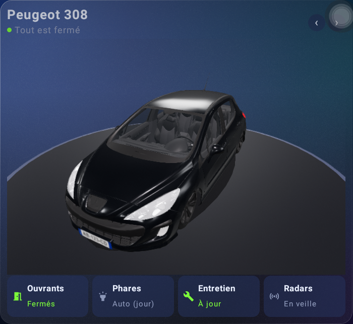 | 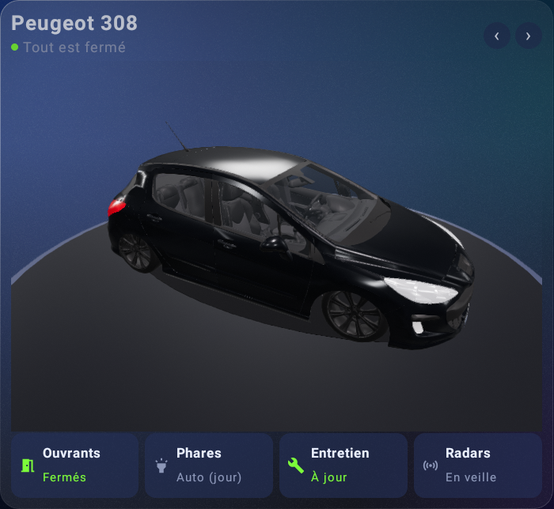 |

### Les onglets de l'appli (mis à jour en v0.16)

Captures prises les 8 et 9 novembre 2026 dans l'émulateur Android (écran 1024 × 600 comme l'autoradio), en **mode démo**
(données simulées). L'émulateur ne sait pas afficher la 3D (Filament) : sur ces captures, la voiture est la vue
de dessus en 2D, celle que l'appli affiche quand la 3D n'est pas disponible. Sur l'autoradio, c'est la 3D ci-dessus.

| Accueil | Véhicule — État |
|---|---|
|  |  |
| **Véhicule — GPS** | **Véhicule — Diagnostic CAN** |
|  |  |
| **Moteur — Puissance** | **Moteur — Diagnostic** |
|  |  |
| **Moteur — Batterie (v0.10)** | **Moteur — Trajets (v0.10)** |
|  |  |
| **Moteur — Chrono** | **Moteur — Bilan et FAP (v0.14)** |
|  | 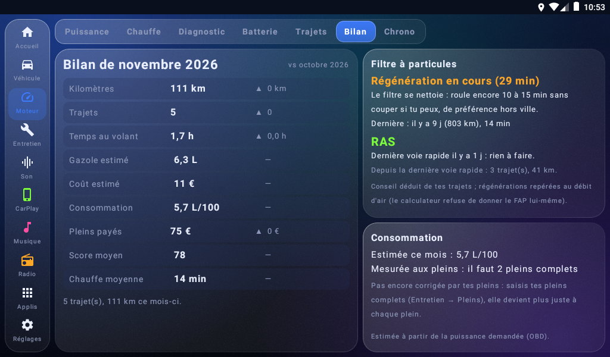 |
| **Moteur — Chauffe (v0.11)** | |
| 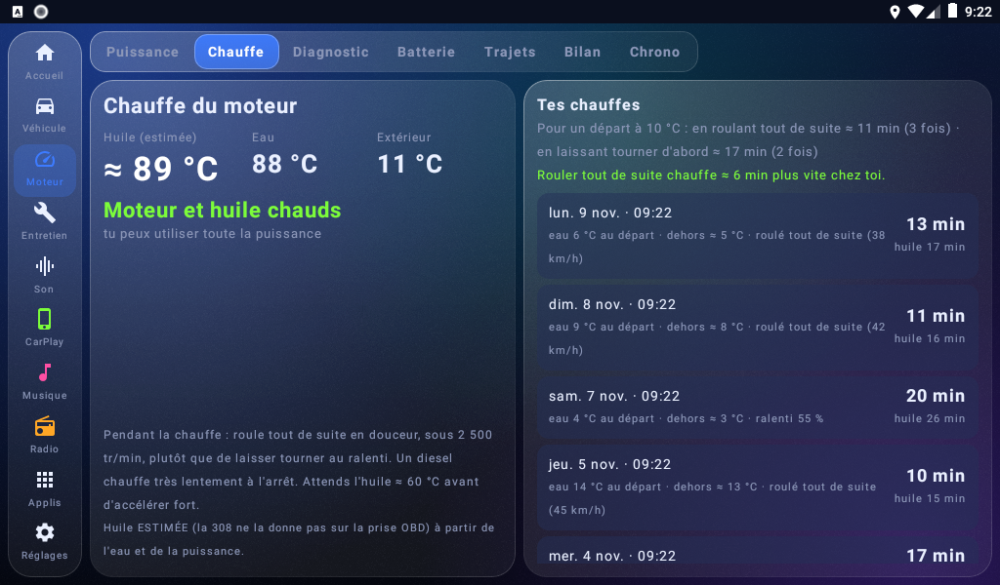 | |
| **Son — Alignement (v0.15)** | **Son — Tests et polarité (v0.15)** |
| 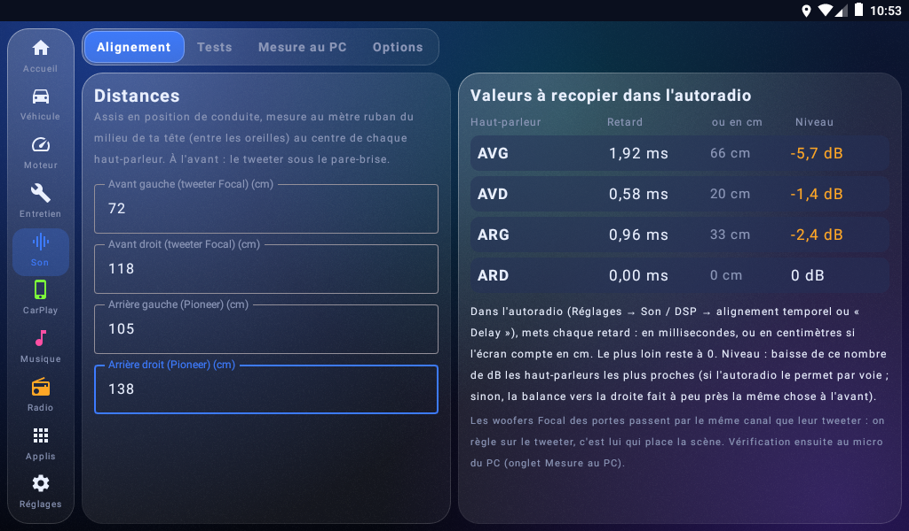 | 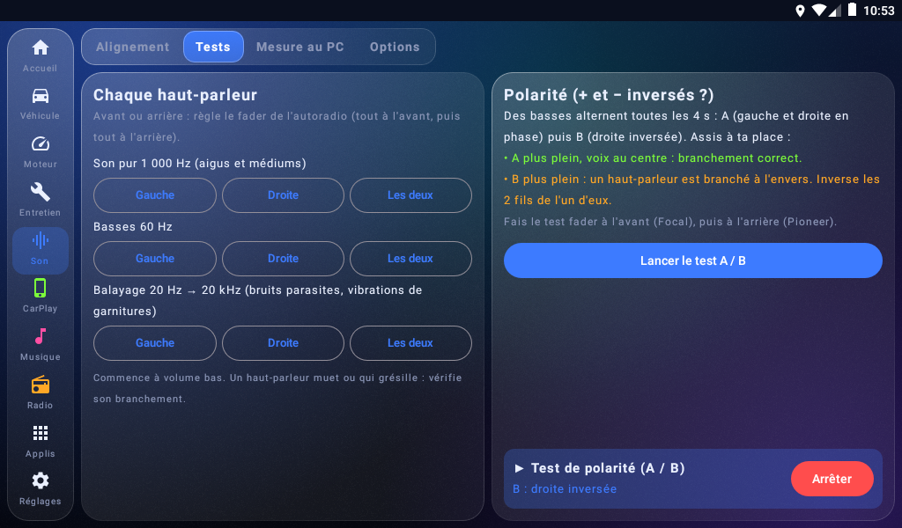 |
| **Son — Mesure au micro du PC (v0.15)** | **Son — Options (v0.15)** |
| 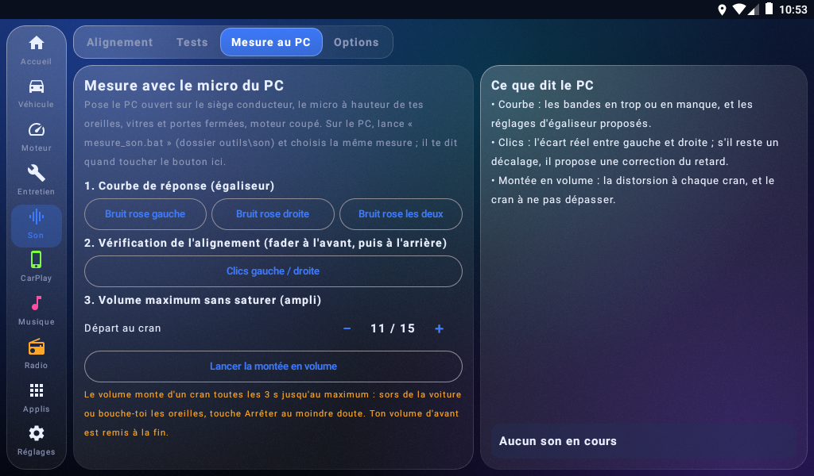 | 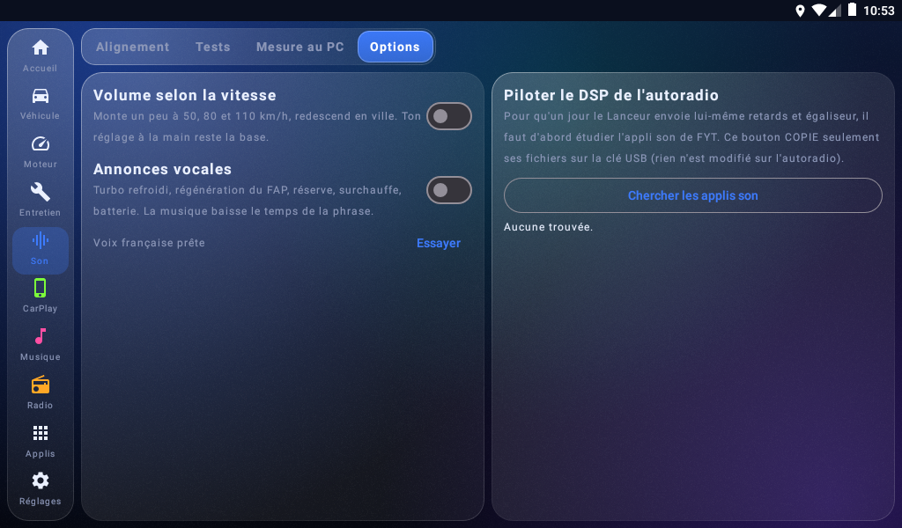 |
| **Optimiser l'autoradio (v0.16)** | **Optimiser — réglages guidés (v0.16)** |
| 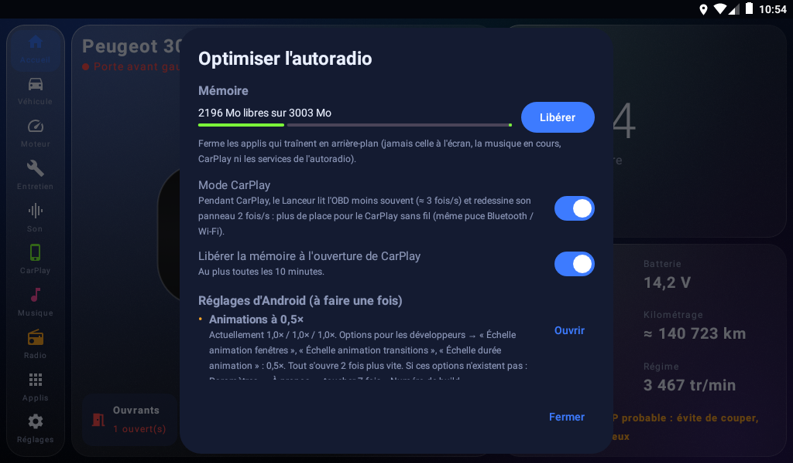 | 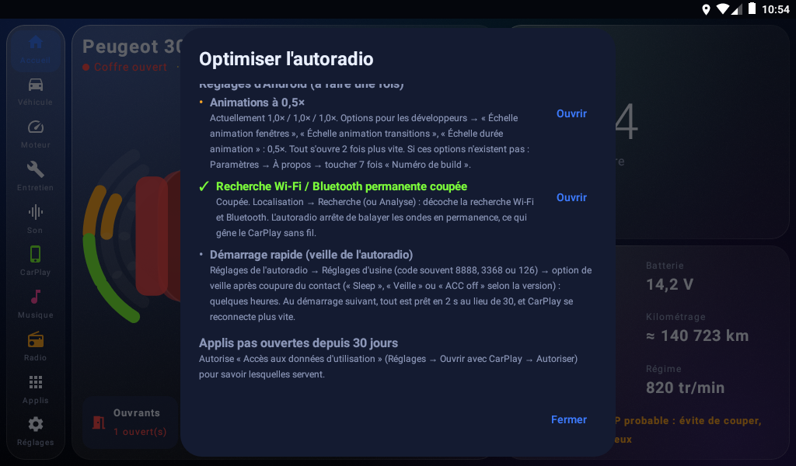 |
| **Entretien** | **Entretien — Pleins** |
|  |  |
| **Réglages** | **Panneau à côté de CarPlay (v0.13, alerte FAP v0.14)** |
|  |  |

**Nouveau en v0.32 : « Passagers » automatique, redémarrage de l'autoradio (11/11 au soir, pas encore essayés sur l'autoradio)**
- Les ceintures ne sont pas transmises (essai du 11/11) : `sound/SeatAuto` (calcul pur, 3 tests `SeatAutoTest`) passe en
  « Passagers » quand une porte passager (7/2, 7/3, 7/4) vient de s'ouvrir, en mode « Seul », option active, à 5 km/h
  au plus. Branché dans `VehicleWatchService` (bandeau + ligne `[SON]` au journal, `ChampService.apply`). Choix
  automatique noté (`SoundPrefs.seatAuto`) : au démarrage suivant de l'autoradio (service lancé moins de 5 min après
  l'allumage), il revient à « Seul » (application 20 s plus tard). Un choix à la main n'est jamais changé.
  Limite connue : des passagers montés avant l'allumage de l'autoradio ne sont pas vus.
- **Redémarrer l'autoradio** (Applis → « ⟳ Redémarrer l'autoradio », confirmation) : `DevOptions.reboot` essaie`n  `setprop sys.powerctl reboot`, puis `svc power reboot` et `reboot` (une appli n'a pas le droit REBOOT ; ça passe`n  parce que SELinux est « Permissive »). Essayé dans l'émulateur mis en Permissive : il redémarre. Pas encore sur l'autoradio.
**Nouveau en v0.31 : batterie par le CAN, son « Seul / Passagers », page « Mon autoradio » (11/11, essayée dans l'émulateur, pas encore sur l'autoradio)**
- **Batterie** (`vehicle/BatteryWatch.kt`) : tension lue sur le service FYT, module 0 code 114, codage
  `(brut + 4) × 0,1` déduit d'un seul relevé moteur tournant (142 → 14,6 V) : **à confirmer moteur coupé** (le script
  `outils/adb/test_ceintures.ps1` l'affiche). Elle alimente `Vehicle.batteryV`, donc les alertes batterie existantes,
  sans boîtier OBD. Nouveau : minutes passées moteur coupé autoradio allumé (`engineOffMin`, moteur tournant = régime OBD
  > 400 ou tension ≥ 13,2 V) ; rappel vocal, notification et bandeau toutes les 20 min. 4 tests `BatteryWatchTest`.
- **Seul / Passagers** (`sound/ChampService.kt`) : service d'accessibilité limité à `com.syu.eq`, activé à la main
  (ou par `outils/adb/voiture_rapide.ps1`). Un appui ouvre l'égaliseur FYT, touche onglet « Champ », « Tous », puis les
  flèches (`ChampTaps`, positions relevées en 1280 × 720, mises à l'échelle ; ← et ↓ déduites par symétrie, vérifiées par
  le script des ceintures), puis revient. Seul = position trouvée au micro (`champSeul` dans `reglage-son.json`, sinon
  d'après les distances), Passagers = centre. 4 tests `ChampTapsTest`. Pas de passage automatique : les ceintures ne sont pas transmises (essai du 11/11).
- **Véhicule → Mon autoradio** (`vehicle/CarFeatures.kt`, `ui/FeaturesPanel.kt`) : chaque information FYT est notée à
  sa première arrivée (service, boîtier CAN 7/1005, température, tension, volume, portes, marche arrière, autonomie),
  plus OBD, GPS, basses automatiques, égaliseur FYT. Gris = pas encore vu, avec le geste pour le tester.
- **Deux places** : `reglage_auto.py --deux-places` mesure aussi à la place passager avant, égaliseur réglé sur la moyenne
  pondérée des écarts (60 / 40, bandes fiables seulement : `combiner`, testé) ; `--champ-seul 1,3` envoie la position Seul.
- Essai « nouvel utilisateur » dans l'émulateur (installation à zéro) : demande de position, puis bienvenue, Son,
  Mon autoradio : rien de bloquant ; texte de bienvenue complété (« Véhicule → Mon autoradio »).

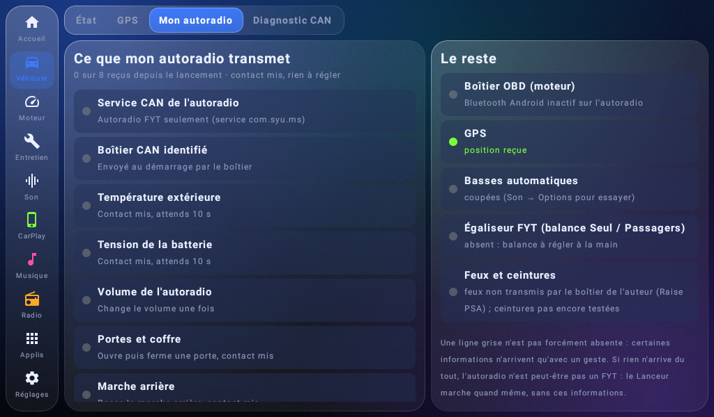

**Nouveau en v0.30 : basses automatiques et réglage du son au micro du PC (11/11, essayé sur l'autoradio)**
- Demande : basses absentes à volume bas, portes qui vibrent à volume fort, pas de caisson (woofers Focal des portes).
- `sound/BassAuto.kt` : `BassCurve.gains` (calcul pur, 6 tests `BassCurveTest`) : graves 40-250 Hz montés jusqu'à +6 dB
  à volume 0, plus rien dès 60 % ; bande la plus proche de la vibration baissée de 0 (50 %) à −6 dB (100 %) ; intensité
  ×0,5 / ×1 / ×1,5. Appliqué par `android.media.audiofx.Equalizer(0, 0)` (session globale ; permission
  MODIFY_AUDIO_SETTINGS) chaque seconde depuis le service, seulement si le volume change. Volume lu sur le service FYT
  (module 4, code 2 = chiffre de la barre du haut ; maximum 36 sur cet autoradio, relevé plus haut s'il le faut), sinon STREAM_MUSIC.
  Si l'autoradio refuse l'égaliseur global : état « refuse » affiché, rien de changé. Radio FM non concernée.
- `ResonanceSweep` : sinus 30 → 150 Hz en 30 s ; « Ça vibre ! (xx Hz) » enregistre la fréquence (`SoundPrefs.resonanceHz`).
- Limite : l'égaliseur d'Android n'a en général que 5 bandes (60, 230, 910 Hz…) : la baisse touche toute la bande
  des 60 Hz (≈ 30-120 Hz), pas seulement la fréquence exacte. Volume FYT maximum = **36** sur cet autoradio.
- **Réglage automatique depuis le PC** (`outils/son/reglage_auto.py`, voir `outils/son/REGLAGE_SON.md`) : le PC pilote
  l'autoradio par ADB Wi-Fi, mesure au micro, règle l'égaliseur FYT 15 bandes (`fyt_eq.py`, points glissés) et envoie la
  fréquence à baisser au Lanceur (`reglage-son.json`, importé par `Import.kt`). **Essai du 11/11** : avec le micro par
  défaut du PC (réseau de micros avec réduction de bruit) la mesure était fausse et rien n'a été touché ; avec le micro
  brut (n° 19 « … SST », `--micro 19`), volume 24/36 : bosse 80-125 Hz, pic 630-800 Hz, aigus forts → écart moyen à la
  cible **4,8 dB → 1,8 dB**. Aucune vibration de porte détectée jusqu'à 30/36. Options ajoutées : `--monter N` (le PC
  monte le volume de N crans pour la recherche de vibration puis le remet), `--oui` (sans Entrée).
- Leçon : la variante émulateur (`build_emu.ps1`, 24 Mo, 3D coupée) écrase `app-release.apk` ; toujours reconstruire la
  vraie version en dernier. `outils/adb/voiture_rapide.ps1` refuse une APK de plus de 20 Mo.

**Nouveau en v0.29 : onglet Son adapté à l'égaliseur FYT (11/11)**
- Relevé par ADB de `com.syu.eq` : EQ 15 bandes (25 Hz-16 kHz, ±12), ASP basses/aigus ±10 + préréglages, onglet **Champ =
  croix balance/fader de 8 crans de chaque côté** ; ses boutons sont des positions (Mode de conduite = −4, +4 ; Copilote =
  +4, +4 ; Arrière = 0, −4 ; Tous = centre). **Aucun retard par haut-parleur** : les ms de l'ancien onglet étaient
  impossibles à recopier. Réglage de l'auteur relevé puis remis tel quel : 0, +2.
- `sound/FytStage.kt` (calcul pur, 5 tests `FytStageTest`) : crans à droite = 20·log10(d_loin/d_près) / 1,5 dB (estimation,
  bornée à 8), avant = 2. L'onglet Alignement montre la croix à viser, les étapes, « Ouvrir l'égaliseur » et un bruit rose
  sur les deux voies pour finir à l'oreille. `TimeAlignment` (ms) gardé dans le code mais plus affiché.
- Essayé sur le vrai autoradio par ADB (valeurs d'essai 70 / 110 cm → 3 crans à droite, puis effacées).

**Nouveau en v0.28 : température FYT directe, cadrage 3D, première séance ADB par le Wi-Fi (11/11)**
- **ADB par le Wi-Fi marche** : autoradio et PC sur le partage de l'iPhone, autoradio trouvé sur le port 5555 (172.20.10.3
  ce jour-là). Écran réel **1280 × 720, densité 160** (pas 1024 × 600). Chaque essai de cette version a été fait sur le vrai
  autoradio (installation par `adb install -r`, même clé de signature).
- **Température extérieure** : `OutsideTemp.decodeFyt` lit le canal FYT standard **module 0, code 40** (dixièmes de degré
  + 1000, bits 30-31 = pas de donnée, bit 28 = °F ; repéré dans Dashphonic, MIT). L'apprentissage ne pouvait pas le trouver :
  ce codage manquait à sa liste (ajouté aussi). Vérifié : 17,0 °C affichés comme la barre du haut. 4 tests (`OutsideTempTest`).
- **Cadrage 3D** (`Car3D.kt`) : focale 30 → 25 et point visé −0,08 → −0,38 : voiture entière visible, plaques comprises.
- **Relevé CAN moteur tournant** (rapport `diagnostic-can.txt`, non publié) : module 0 code 114 = tension batterie
  ((brut + 4) × 0,1 = 14,6 V), 115 et 146 = inconnus qui varient, 101 = bascule 0/1, 77 = coordonnées du toucher ;
  module 7 code 1000 = type de boîtier (1245523), 1005 = « PSA-RZ-15-0127-B1 ». Rien de nouveau sans ouvrir de porte.

**Nouveau en v0.27 : droits d'auteur et crédits (11/11)** — [LICENSE.md](LICENSE.md) (tous droits réservés, usage
personnel gratuit), [CREDITS.md](CREDITS.md), et la mention en bas des Réglages (vérifiée dans l'émulateur). 40 tests verts.

**Nouveau en v0.26 : bilan « Prêt à partir », carnet d'entretien en PDF, CHANGELOG et CONTRIBUTING (11/11)**
- **Bilan « Prêt à partir »** (`drive/ReadyCheck.kt`, calcul pur ; `ui/ReadyDialog.kt`) : 8 s après le lancement, à l'arrêt,
  une fenêtre résume verglas (température lue sur l'autoradio ≤ 3 °C, jamais l'estimation), batterie (alerte en cours,
  sinon dernier démarrage de moins de 21 jours), carburant (autonomie du CAN, sinon celle des pleins ; alerte < 50 km),
  entretien (en retard / bientôt). Un sujet sans donnée n'a pas de ligne ; rien à dire = pas de fenêtre. Se ferme en 15 s,
  pas plus d'une fois par 30 min, interrupteur et bouton « Voir » dans les Réglages. 6 tests (`ReadyCheckTest`).
- **Carnet d'entretien en PDF** (`backup/MaintenancePdf.kt`, `android.graphics.pdf.PdfDocument`, A4) : échéances puis
  interventions avec prix. Bouton « Carnet en PDF » dans Entretien → Historique, et écrit dans `export/` à chaque sauvegarde.
  4 tests sur la mise en lignes (`MaintenancePdfTest`).
- **[CHANGELOG.md](CHANGELOG.md)** et **[CONTRIBUTING.md](CONTRIBUTING.md)** ; pastilles numérotées du guide PDF corrigées
  (elles étaient étirées : `.step > div` s'appliquait aussi à `.num`).
- **Vérifié** : 40 tests ; dans l'émulateur, bilan au lancement (démo) et avec un faux carnet importé (contrôle technique en
  retard → alerte), PDF généré et relu page par page. **Pas vérifié** sur l'autoradio.
- Idées d'autres projets triées le 11/11 : écartées = musique/appels (refusée), pont AIDL, multi-firmwares, modules, moto,
  accueil à widgets ; plus tard = PIDs déclaratifs, OBD Wi-Fi/USB ; bouton de don = dès que l'auteur a un compte.

**Nouveau en v0.25 : guide PDF Antigravity, corrections trouvées par la démonstration sur une Clio (10/11, nuit)**
- **Démonstration réelle** : dépôt cloné depuis GitHub comme un inconnu, `ADAPTER.md` suivi pour une Renault Clio 3 1.2 16V
  essence (seul `CarProfile.kt` modifié), tests, construction, installation dans l'émulateur. Elle a trouvé deux défauts :
  - **9 tests en échec** dès qu'on change de voiture (ils vérifiaient le couple et l'étagement de la 308) : une IA
    suivant ADAPTER.md restait bloquée. Ils sont maintenant **ignorés** hors de la 308 (`Author308.kt`, `onlyForAuthor308()`) ;
    `CarProfileTest` reste actif. ADAPTER.md précise que ~14 tests ignorés, c'est normal.
  - **Saisie de la plaque** : la mise en majuscules pendant la frappe faisait doubler les mots par le clavier Android
    (« clio-3 » → « CLIO-CLIO- »). Le clavier met maintenant les majuscules lui-même ; le texte est normalisé à « Poser ».
- Libellé « Décoche pour une 308 3 portes » → « … une voiture 3 portes ».
- **`docs/guide-antigravity/`** : guide PDF de 10 pages (installation d'Antigravity, questions de l'IA, fiche, adaptation,
  installation sur l'autoradio écran par écran) + `guide.html` (source) + captures. Captures réelles d'Antigravity (10/11, prises en pilotant l'appli de l'utilisateur) : modèle **Gemini 4 Argon High** (le plus récent gratuit ; Gemini 4 Carbon « Unavailable »), questions en 24 s, fiche conforme, un seul fichier modifié, tests 16 OK / 14 ignorés, APK fabriquée en ~3 min.

**Nouveau en v0.24 : adaptation à d'autres voitures par une IA, modèle 3D public publié (10/11, nuit)**
- **`vehicle/CarProfile.kt`** : tout ce qui dépend de la voiture est regroupé dans ce seul fichier (nom affiché, moteur,
  courbe de couple, étagement de boîte, réservoir et réserve, présence d'un FAP et d'un turbo, lecture du kilométrage
  propre aux PSA). Valeurs inchangées pour la 308 ; `Engine.kt`, `ShiftAdvice.kt`, `Insights.kt`, `Screens.kt`,
  `Dialogs.kt` et `VehicleWatchService.kt` les lisent. `HAS_DPF`/`HAS_TURBO` coupent le suivi FAP / turbo,
  `PSA_ECU_ODOMETER = false` n'envoie plus la requête PSA. 4 tests (`CarProfileTest`) refusent les valeurs impossibles.
- **[ADAPTER.md](ADAPTER.md)** : feuille de route pour l'IA de n'importe qui (Claude, Antigravity gratuit, ChatGPT…) :
  un seul message de questions, une fiche « ce qui marchera chez toi », puis au besoin un seul fichier à modifier et
  une construction. Pensée pour tenir en ~6 requêtes. `AGENTS.md`, `CLAUDE.md`, `GEMINI.md` et `.agent/rules/`
  renvoient vers lui ; `INSTALLER.md` donne le message à copier dans son IA.
- **Modèle 3D public publié** : `assets/models/car.glb` (plaque d'exemple, CC BY 4.0) est maintenant sur GitHub, exception
  dans `.gitignore`. Le projet se compile donc chez n'importe qui. Le modèle personnel (`modele-3d/car.glb`, vraie plaque)
  reste ignoré. ADAPTER.md décrit les noms de nœuds et de matériaux qu'un autre modèle doit avoir.

**Nouveau en v0.23 : plaque personnalisée, écran de bienvenue, guide d'installation public (10/11, nuit)**
- **But** : que n'importe qui puisse installer l'appli (vidéo de présentation à venir). Le seul vrai blocage était la
  plaque, dessinée dans le modèle 3D donc présente dans chaque APK.
- **Modèle public** : `outils/plaque_glb.py` remplace l'image de la plaque du modèle personnel par une plaque d'exemple
  « AB-123-CD » (`modele-3d/plaque-factice.png`) et lui réserve 128 Ko. Résultat : `modele-3d/car-public.glb`, **c'est
  lui qui est maintenant dans `assets/models/car.glb`**. Plus aucune APK ne contient la vraie plaque.
- **Réglages → Plaque** (`ui/Plate.kt`) : l'utilisateur tape sa plaque, l'appli la dessine (aperçu dans la ligne),
  puis écrit dans son dossier privé une copie du modèle où seule l'image de la plaque est remplacée, **sur place et à
  taille égale** (`GlbPlate.replace` : rien d'autre ne bouge dans le fichier). `CarModel.location` charge cette copie ;
  si elle ne s'affiche pas, retour automatique au modèle d'origine (ligne `[PLAQUE]` au journal, sans le texte de la
  plaque). La copie est refaite après chaque mise à jour de l'appli. 5 tests (`GlbPlateTest`).
- **Écran de bienvenue** au premier lancement (`WelcomeDialog`) : à quoi sert l'appli, mode démo, plaque, boîtier OBD.
- **[INSTALLER.md](INSTALLER.md)** : guide pour le public (installation, premier lancement, ce qui marche selon la
  voiture, questions fréquentes). Licence du modèle 3D vérifiée sur Sketchfab le 10/11 : CC BY 4.0 (crédit obligatoire).
- **Vérifié** : tests ; modèle public rendu dans three.js (plaque d'exemple à l'endroit, avant et arrière) ; dans
  l'émulateur, bienvenue, aperçu pendant la frappe et bouton « Poser », puis le modèle fabriqué par l'appli relu dans
  three.js (la plaque tapée y est, même taille de fichier). **Pas vérifié** : l'affichage sur l'autoradio
  (l'émulateur ne sait pas afficher la 3D) ; le chargement d'un modèle depuis un fichier n'y a jamais été essayé.

**Nouveau en v0.22 : ADB par le Wi-Fi depuis les Réglages, sauvegarde moins fréquente (10/11 au soir)**
- **Ce que la clé du 10/11 a appris** (fiche `infos-autoradio.txt` de la v0.19, voir le tableau du §1) : le vrai
  processeur est un Spreadtrum SC7731E 32 bits sous Android 8.1 ; le débogage est bien activé et `adbd` tourne, mais
  sans port réseau ; système `user` (pas d'`adb root`, pas de `su`) ; **SELinux en mode « Permissive »**.
- **ADB par le Wi-Fi** (Réglages → « ADB par le Wi-Fi (pour le PC) » → Activer, `ui/DevOptions.kt` → `setWifiAdb`) :
  le Lanceur lance `setprop service.adb.tcp.port 5555` puis `setprop ctl.restart adbd`, relit la valeur et dit si
  l'autoradio a accepté. Avec SELinux « Permissive », une appli ordinaire y arrive (vérifié dans l'émulateur Android 8 :
  refusé en « Enforcing », accepté en « Permissive », `adbd` relancé, adresse affichée). Le réglage disparaît au
  redémarrage. Sur le PC : `adb connect <adresse>:5555`, puis accepter la demande sur l'écran de l'autoradio
  (`ro.adb.secure = 1`). **Pas encore essayé sur l'autoradio.**
- **Sauvegarde automatique** : le kilométrage n'en est plus un déclencheur (`AutoBackup.kt`). En roulant, il
  changeait à chaque kilomètre : la clé montrait une sauvegarde complète par minute (traces GPS réécrites), ce qui
  chargeait l'autoradio pour rien. Restent : fin de trajet, démarrage ou chauffe enregistrés, clé branchée, 6 h.
- **Vu dans le journal du 10/11** : kilométrage du calculateur lu (140 832 km, correctif v0.18 confirmé) ; **l'eau
  plafonne à 73-75 °C** sur deux trajets de 40 min (thermostat à faire vérifier) ; à cause de cela l'apprentissage du
  FAP avance très lentement (il exige 75 °C) ; nettoyage automatique de la mémoire : gain faible (+12 Mo).

**Nouveau en v0.21 : bouton « Options pour les développeurs » (10/11)**
- Les réglages de l'autoradio ne montrent pas la page développeur d'Android (essai ADB du 10/11, voir §1). Le Lanceur
  l'ouvre lui-même : Réglages → « Options pour les développeurs » → **Ouvrir** (`ui/DevOptions.kt`). La ligne affiche
  l'état (« Débogage USB : activé / coupé »).
- Tant que les options ne sont pas activées, Android 8 referme la page développeur aussitôt (vu dans l'émulateur) :
  le bouton ouvre alors « À propos » d'Android, où il faut appuyer 7 fois sur « Numéro de build », puis revenir et
  rappuyer sur Ouvrir. Le Lanceur sait quelle page s'ouvrira en le demandant à Android (`resolveActivity`).
- Bouton « Réglages Android » : ouvre les vrais réglages d'Android (pas ceux du fabricant).
- Le Lanceur ne change aucun réglage lui-même. **Vérifié dans l'émulateur Android 8 (parcours complet) ; pas sur
  l'autoradio**, où le fabricant a pu retirer ces pages : le bouton le dit alors.

**Nouveau en v0.20 : journal des plantages sur la clé USB (10/11)**
- **Plantages enregistrés** (`backup/CrashLog.kt`, installé en tout premier dans `App.onCreate`) : si l'appli plante,
  le détail (pile d'appels, version, fil, mémoire libre) est écrit dans `plantages/plantage-<date>.txt`, dans la
  mémoire de l'appli et tout de suite sur la clé si elle est branchée. Au lancement suivant, `AutoBackup` le signale
  au journal (`[PLANTAGE]`) et le recopie sur la clé. 20 plantages gardés au plus. Android ferme ensuite l'appli
  comme avant (gestionnaire d'origine rappelé). But : savoir pourquoi l'appli plante dans la voiture, sans ADB.
- Ne contient ni position ni identifiant ; reste sur la clé, jamais publié.

**Nouveau en v0.19 : fiche technique de l'autoradio écrite sur la clé USB (09/11 au soir)**
- **Fiche technique** (`backup/DeviceInfo.kt`, lancée par `AutoBackup.tick` une fois par lancement dès qu'une clé est
  branchée) : écrit `Android/data/fr.p308.lanceur/files/infos-autoradio.txt` sur la clé (et en mémoire interne). On y
  trouve ce que le tableau du §1 ne dit pas : version réelle d'Android et correctif de sécurité, type de système
  (`user` / `userdebug`), `ro.debuggable`, `ro.secure`, état du débogage ADB et des options développeur, SELinux,
  démarrage vérifié, présence d'une commande `su`, noyau, processeur, mémoire, stockage, partitions, toutes les
  propriétés système (`getprop`) et la liste des applis installées (système / ajoutée / désactivée).
- **But** : savoir depuis le PC ce que l'autoradio permet (mode développeur ADB, `adb root`, ou rien) avant de tenter
  quoi que ce soit. **Lecture seule** : l'appli ne modifie rien sur l'autoradio.
- **Vie privée** : les numéros de série, adresses réseau et identifiants sont retirés de la fiche. Le fichier reste sur
  la clé : **il n'est jamais publié dans ce dépôt**.
- Non vérifié sur l'autoradio (compilation seulement) : certaines lignes peuvent dire « illisible » ou « impossible »,
  Android 8 interdisant quelques lectures à une appli ordinaire.

**Nouveau en v0.18 : mémoire libérée toute seule, kilométrage du calculateur (09/11 au soir)**
- **Mémoire automatique** (`optim/Optim.kt` → `autoTick`, appelé toutes les 30 s par `VehicleWatchService`) : dès
  qu'il reste moins de 25 % de mémoire libre (≈ 380 Mo sur 1536) ou qu'Android se dit à court, le Lanceur ferme les
  applis en arrière-plan, avec les mêmes protections que le bouton « Libérer » (jamais l'appli à l'écran, la musique
  en cours, CarPlay, le clavier ni les services de l'autoradio). Au plus une fois toutes les 5 min ; si le
  nettoyage n'a presque rien rendu (moins de 15 Mo), le suivant attend 20 min. Interrupteur et bilan (« 3 fois,
  210 Mo rendus ») dans Réglages → Optimiser l'autoradio ; chaque passage est noté au journal (`[OPTIM]`).
  Limite connue : sans root, une appli ne peut fermer que ce qui est en arrière-plan ; Android relance ce dont il
  a besoin.
- **Kilométrage du calculateur moteur** (`Engine.kt` → `readEcuKm`) : dans la voiture, la v0.17 n'obtenait
  aucune réponse (« NO DATA », même à `3E00`), alors que l'outil PC lit le kilométrage avec le même boîtier.
  Deux corrections tirées de la séance OBD n° 2 : le dialogue s'ouvre avec `81` et se ferme avec `82` (au lieu de
  `10C0` / `1081`), et la question est posée **avant** toute question OBD normale à la connexion, comme le fait
  l'outil PC. En cas d'échec, 3 nouveaux essais au plus par connexion, chacun après un silence de 3 s puis 6 s
  (hypothèse : le calculateur ignore le diagnostic tant qu'un dialogue OBD normal est en cours). Les réponses
  brutes sont écrites au journal (`[KM]`). **À confirmer dans la voiture.**
- **Journal moins bavard** : la ronde « Recherche vLinker… / Aucun boîtier OBD détecté » écrivait deux lignes
  toutes les 14 s quand le boîtier était absent (27 min de lignes le 09/11) ; un même message n'est plus réécrit
  qu'au bout de 10 min.
- Séance OBD n° 2, partie A (vLinker seul) : 3 calculateurs sur 90 répondent sur ce réseau (moteur, ABS Bosch 8.1,
  direction assistée électro-hydraulique), aucun code défaut ; le service 21 du moteur ne donne pas de mesure en
  direct (les mesures restent celles des PID standard). Détails de la méthode : `outils/obd/SEANCE_OBD_2.md`.

**v0.17 : corrections après le premier retour terrain (09/11, voiture encore en 0.13)**
- **Température extérieure** (`vehicle/OutsideTemp.kt`, Réglages → Température extérieure) : l'estimation par l'air
  d'admission est supprimée (elle donnait 39 °C en novembre, moteur encore tiède). L'autoradio l'affiche via son
  service CAN (`com.syu.ms`), mais le canal dépend du boîtier : l'utilisateur recopie la valeur affichée, l'appli
  garde les couples (module 0/7, canal 0..300, rang 0..3, codage v, v/2, v/10, v-40, v/2-40, signé 8/16 bits) qui
  la donnent, puis les recoupe à une autre température jusqu'à n'en garder qu'un (préférences « can »).
- **Chauffe** (`vehicle/Warmup.kt`) : une chauffe plus de 2,5 fois plus longue que la normale (39,5 min depuis 43 °C
  le 09/11) ou dont l'eau a plafonné (10 min de roulage à 30 km/h ou plus sans gagner 2 °C, sous 80 °C) est
  « anormale » : affichée, jamais utilisée pour prévoir (elle faisait prévoir plus de 40 min à chaque départ).
  Plafond en cours = message « thermostat peut-être resté ouvert ».
- **Kilométrage** : la lecture 21 10 (6A8 → 688) ouvre maintenant la session de diagnostic PSA `10C0` dès le 2e
  essai, comme l'outil PC du 08/11 qui y arrivait (`1081` ensuite). Cause du kilométrage faux : l'import des
  factures avait posé celui de la dernière vidange faute de relevé moteur ; à corriger une fois à la main.
- **Clé USB** (`backup/UsbStorage.kt`) : toute mémoire de l'appli hors mémoire interne et montée compte comme clé
  (la clé n'était pas toujours « amovible » pour Android : « aucune clé » à l'export). Écriture dans un `.tmp`,
  sync, puis renommage : le 09/11, une copie coupée avait laissé des fichiers de 0 octet. Restauration : saute un
  fichier vide et prend la sauvegarde datée la plus récente.
- **Panneau CarPlay déplaçable** (`service/PerfOverlay.kt`) : glisser = déplacer (colonne de gauche à droite,
  pastille partout), position gardée ; toucher = réduire, appui long = fermer ; changer de côté la remet à sa place.

**Nouveau en v0.16 : optimisation de l'autoradio** (Réglages → Optimiser l'autoradio ; `optim/Optim.kt`,
`ui/OptimDialog.kt`). Android 8 sans root ni ADB : seulement ce qu'une appli normale peut faire, le reste guidé.
- **Mode CarPlay** : pendant CarPlay, boucle OBD ralentie (pause de 300 ms par tour moteur tournant ; jamais moteur
  coupé, pour le démarreur) et panneau redessiné 2 fois/s au plus (une nouvelle alerte passe tout de suite). But :
  laisser la puce Bluetooth / Wi-Fi 2,4 GHz et le processeur au CarPlay sans fil.
- **Mémoire** : `killBackgroundProcesses` sur les applis en arrière-plan (jamais : com.syu / com.fyt, système vital,
  CarPlay / musique / radio choisis, clavier, Lanceur ; Android épargne aussi ce qui est visible ou joue). Bouton +
  automatique à l'ouverture de CarPlay (10 min mini entre deux).
- **Réglages guidés** avec état relu : animations 0,5×, recherche Wi-Fi / Bluetooth permanente, mises à jour auto du
  Play Store, veille / démarrage rapide FYT (réglages d'usine).
- **Applis pas ouvertes depuis 30 jours** (accès aux données d'utilisation) → page Android pour les désactiver.

**Nouveau en v0.15 : onglet Son** (dock → Son ; code dans `sound/` et `ui/SoundScreen.kt`) :
- **Alignement temporel** : distances oreille → haut-parleur (tweeters sous le pare-brise, arrière) → retard de
  chaque voie ((d_max − d) / 34,3 cm/ms) et baisse de niveau (20·log10(d / d_max)), à recopier dans le DSP.
- **Tests** : son pur 1 kHz et 60 Hz, balayage, par côté ; **polarité** A (en phase) / B (droite inversée).
- **Mesure au micro du PC** (`outils/son/mesure_son.bat`, fiche `outils/son/REGLAGE_SON.md`) : bruit rose → écart à
  une courbe « voiture » par tiers d'octave et réglages d'égaliseur 10 bandes (+ graphique SVG) ; clics gauche puis
  droite à 500 ms exactes → décalage restant ; montée en volume d'un son pur 400 Hz → distorsion par palier et volume
  maximum sans saturer l'ampli. Analyse testée sur signaux synthétiques (`test_mesure_son.py`).
- **Volume selon la vitesse** (paliers 50 / 80 / 110 km/h, intensité réglable, le réglage à la main reste la base) et
  **annonces vocales** (turbo refroidi, régénération du FAP, réserve, surchauffe, batterie ; musique baissée).
- **DSP de l'autoradio** : pas encore piloté (commandes inconnues). Bouton qui copie seulement les APK des applis son
  du système sur la clé pour les étudier (`QUERY_ALL_PACKAGES` ajoutée pour les trouver).

**Nouveau en v0.14** :
- **Régénérations du FAP** (`vehicle/FapRegen.kt`) : l'EDC16C34 refuse de donner le FAP aux lectures autorisées
  (services 21, 22 et 1A, séance du 08/11/2026). Pendant une régénération il ferme la vanne EGR : le débitmètre
  (PID 10, désormais lu ≈ 1 fois par seconde) voit alors bien plus d'air frais. Le Lanceur apprend le débit normal
  moteur chaud par case régime × charge, puis signale une régénération probable quand le débit reste ≥ 25 % au-dessus
  pendant 2 min (charge 8-69 %, 750-3 250 tr/min). Moins de 4 min : ignoré ; moteur coupé pendant : « interrompue ».
  Affichage : accueil, panneau CarPlay (« continue de rouler » / « évite de couper »), Moteur → Bilan (dernière,
  intervalle moyen), bandeau au début, notification si coupée, `regenerations-fap.csv` à l'export, journal OBD
  (débit mesuré et attendu, pour vérifier). Une régénération complète remet à zéro le conseil voie rapide.

**Nouveau en v0.13.1** :
- **Autonomie estimée** (`drive/Insights.kt`, `FuelRange`) : réservoir de 60 L au dernier plein complet, moins les
  km parcourus × la conso (mesurée entre les pleins, sinon estimée, sinon 6 L/100), plus les pleins partiels ;
  donnée jusqu'au témoin de réserve (≈ 6 L). Affichée sur l'accueil, dans Pleins et dans le panneau CarPlay ;
  bandeau sous 50 km.
- **Refroidissement du turbo** (`vehicle/TurboCool.kt`) : secondes de ralenti conseillées avant de couper, qui
  montent pendant l'effort (jusqu'à 60 s, ≈ 5 min de voie rapide) et descendent en roulant doucement ou au ralenti.
  À l'arrêt : « Turbo chaud : attends N s » puis « Turbo refroidi ✓ » (accueil et panneau CarPlay) ; coupure
  moteur turbo chaud notée dans le journal OBD.

**Nouveau en v0.13** :
- **Journal OBD** (`vehicle/ObdLog.kt`) : connexions, chaque essai de lecture du kilométrage avec la réponse brute,
  démarrages (chute saisie ou non), tensions ; 14 jours gardés, copiés sur la clé (dossier `journal/`).
- **Panneau CarPlay** : taille Auto (complet pendant la chauffe ou en cas d'alerte, pastille une fois chaud),
  alertes (surchauffe, charge batterie anormale, FAP à nettoyer vite ; la pastille clignote), consommation
  instantanée. Ouverture automatique quand CarPlay passe au premier plan (`service/CarPlayWatch.kt`, autorisation
  « Accès aux données d'utilisation » donnée à la main).
- **Tracé de chaque trajet** (`ui/TripTrace.kt`) d'après les journaux GPS, coloré selon la vitesse, sans fond de carte.
- **Vidange adaptée à l'usage** (`maintenance/Wear.kt`) : les petits trajets avancent l'échéance (jusqu'à × 1,6).
- **Santé de la batterie dans le temps** : démarrages comparés (froid pris en compte), estimation des semaines
  restantes, alerte quand elle se dégrade.
- **Export pour Excel** (`backup/Export.kt`) : trajets, pleins, démarrages, chauffes, historique en CSV sur la clé.
- **Historique des interventions + import des factures** (`maintenance/History.kt`, `backup/Import.kt`) : un fichier
  `import-entretien.json` posé sur la clé (Android/data/fr.p308.lanceur/files/) est fusionné une fois (historique,
  dates et km des entretiens, kilométrage vers le haut seulement), puis renommé `.importé`. Les données
  personnelles (factures) ne sont jamais dans ce dépôt.

**Nouveau en v0.12.3** : panneau CarPlay réduit en pastille en haut (point coloré selon l'eau / l'huile, rapport,
conseil ▲▼, ch, eau, minutes de chauffe restantes). Toucher passe de la colonne à la pastille ; le choix est gardé
(Réglages → « Taille du panneau » : Complet / Réduit).

**Nouveau en v0.12.2** : panneau CarPlay refait en style verre (`service/PerfOverlay.kt`) : rapport et conseil,
puissance et couple (Nm), temps de chauffe restant avec barre de progression (« Moteur chaud ✓ » ensuite), eau,
huile estimée, turbo et régime avec une barre colorée chacun (bleu froid, orange tiède, vert chaud, rouge trop chaud),
batterie. Réduit : rapport conseillé, puissance et minutes de chauffe restantes.

**Nouveau en v0.12.1** : kilométrage jamais perdu (`vehicle/Vehicle.kt`). Si le calculateur ne répond pas au
démarrage, le dernier relevé (moteur ou saisi) reste la base et le GPS ajoute les km parcourus, affichés « ≈ » avec
leur origine (« +44 km GPS depuis le 8 nov. »). Sans GPS (tunnel, parking couvert), la vitesse OBD prend le relais
(jamais les deux à la fois). Un relevé moteur plus petit que le précédent est refusé (lecture faussée) ; une saisie
à la main remet tout à zéro. Onglet Diagnostic : le kilométrage estimé s'affiche au lieu de « — ».

**Nouveau en v0.12** :
- **Style Verre** (`ui/Theme.kt`, réglage « Style Verre ») : panneaux translucides à liseré lumineux sur fond dégradé
  coloré. Sans flou en temps réel (trop coûteux sur l'autoradio) : dégradés calculés une fois par taille.
- **Consommation estimée** (`drive/Insights.kt`) : ≈ 0,3 L/h + 0,27 L par kWh fourni (puissance OBD), corrigée par
  les pleins complets (médiane des 5 derniers écarts). Par trajet, par mois, en euros (prix du dernier plein).
- **Conseil FAP** : compté depuis le dernier trajet avec 15 min à 70 km/h ou plus ; conseil à 10 petits trajets ou
  300 km, urgent à 20 ou 600 km ; notification au plus tous les 3 jours.
- **Moteur → Bilan** : mois en cours comparé au précédent (km, trajets, temps, gazole, coût, L/100, pleins, score,
  chauffe).
- **Heure remise à l'heure par le GPS** (`vehicle/GpsClock.kt`) pour l'horloge du Lanceur (une appli ne peut pas changer
  l'heure d'Android) ; fuseau de Paris appliqué en France.
- **Contrôle technique** : rappel 30 jours puis 7 jours avant, invitation à saisir la date du dernier contrôle.

**Nouveau en v0.11** :
- **Moteur → Chauffe** (`vehicle/Warmup.kt`) : température d'huile ESTIMÉE (la 308 ne la donne pas sur l'OBD) :
  l'huile suit l'eau avec 8 min de retard et chauffe plus fort qu'elle sous la charge ; moteur coupé, elle refroidit
  vers l'extérieur (90 min). Temps de chauffe prévu (eau à 80 °C, puis huile) d'après les chauffes passées à
  température de départ comparable, et comparaison des façons de chauffer (rouler tout de suite / ralenti d'abord).
  Le conseil « moteur froid » tient compte de l'huile estimée.
- **Score des passages de vitesse** : chaque montée de rapport est repérée et jugée (trop tard, trop tôt, bien placée,
  régime moyen) ; le conseil ▲ ne compte qu'après 3 s, le moteur qui peine (▼) compte aussi ; détail des points retirés.
- **Batterie au démarrage** : le démarreur coupait souvent la connexion Bluetooth et la mesure était perdue. Les relevés
  sont gardés d'une connexion à l'autre, la tension est lue deux fois plus souvent, « ✓ Prêt » dit quand démarrer ;
  si la chute n'est pas saisie, le repos et la tension de charge (alternateur) sont quand même notés.
- **Sauvegarde automatique** (`backup/AutoBackup.kt`) de tout, en mémoire interne et sur la clé USB : fin de trajet,
  nouveau démarrage ou chauffe, clé branchée, et au moins toutes les 6 h ; 10 copies datées dans `sauvegardes/`.

**Corrigé en v0.10.1** (premiers essais sur la voiture) :
- **Rapport engagé** (`vehicle/GearCalib.kt`) : l'étagement de départ est approché ; l'appli apprend maintenant les
  vrais rapports en roulant (rapport km/h pour 1 000 tr/min compté quand il reste stable, pics = rapports). État et
  bouton « Réapprendre » en bas de Moteur → Puissance.
- **Kilométrage** : moteur tournant, le calculateur répondait trop tard à la demande 21 10. Attente portée à 1 s,
  3 essais, et nouvel essai toutes les minutes moteur coupé (5 min moteur tournant) tant qu'il n'est pas lu.
- **Température extérieure** : la 308 ne la donne pas sur la prise OBD (PID 46 absent). Elle est estimée par l'air
  d'admission quand le moteur est froid (affichée « ≈ »), puis reprise pendant 3 h.
- Les PID 46 et 42, absents, ne sont plus demandés : 400 ms gagnées à chaque fois.

**Nouveau en v0.10** :
- **Batterie** (`vehicle/CrankWatch.kt`) : moteur coupé, la boucle OBD lit la tension (ATRV) plusieurs fois par
  seconde ; au démarrage (régime > 400 tr/min), elle garde la tension au repos et la plus basse au démarreur.
  Repères : plus de 10,2 V = bonne, 9,6 à 10,2 V = à surveiller, moins de 9,6 V (ou repos sous 12,0 V) = faible,
  avec alerte. Il faut que le boîtier soit connecté avant de lancer le moteur.
- **Trajets** (`drive/TripLog.kt`) : un trajet commence à 5 km/h et se termine après 5 min à l'arrêt ; 100 gardés.
  Score de conduite souple sur 100 : à-coups (plus de 11 km/h par seconde en accélération, 13 au freinage ; 40 pts),
  temps en régime trop haut quand le conseil ▲ s'affiche (30 pts), moteur froid au-dessus de 2 800 tr/min (20 pts).
  Les trajets du mode démo ne sont jamais enregistrés (les exemples affichés en démo sont fictifs).
- **Entretien** : rappel d'assurance ajouté, rappels aussi en bandeau par-dessus CarPlay. Sauvegarde : trajets et
  démarrages inclus.

*Panneau performances : dans l'émulateur, il n'y a pas CarPlay ; l'horloge d'Android a été mise à sa place
sur le bouton CarPlay pour montrer le panneau. Le bandeau rouge est une alerte d'ouvrant du mode démo.*

---

## 0. Résumé en 30 secondes

| | |
|---|---|
| **Quoi** | Appli Android « Lanceur 308 » (`fr.p308.lanceur`) : tableau de bord façon Tesla pour autoradio chinois FYT, avec la 308 en 3D, les ouvrants, les phares, l'OBD, le GPS, l'entretien, le son. |
| **Où en est-on** | Version **0.32** (`versionCode = 38`) prête ; 0.31 publiée sur GitHub (Releases, `Lanceur308.apk`) et installée sur l'autoradio le 11/11. |
| **Ce qui marche dans la voiture** | 3D (plaque tapée, cadrage 1280 × 720), ouvrants et marche arrière par le CAN FYT, température extérieure FYT, phares par l'heure du coucher du soleil, OBD avec le vLinker MC+ (régime, eau, turbo, tension, codes défaut, kilométrage du calculateur), basses automatiques, égaliseur 15 bandes réglé au micro du PC, ADB par le Wi-Fi. |
| **Vérifié le 11/11 au soir (0.31 sur l'autoradio)** | Page Mon autoradio (boîtier, 17 °C, 12,9 V, volume 18, OBD, égaliseur) ; tension moteur coupé 12,8-12,9 V (codage confirmé) ; flèches ← ↓ de la balance justes ; ceintures **non transmises**. Reste à essayer : un appui sur Seul / Passagers depuis le Lanceur. |
| **Comment on travaille** | Une séance dans la voiture doit être courte (batterie) : tout se prépare sur le PC, puis un seul script par ADB Wi-Fi (`outils/adb/`). |

---

## 1. Contexte matériel

### Voiture
- **Peugeot 308 T7** phase 1 (2007), **1.6 HDi 110 ch** (moteur DV6TED4, calculateur Bosch EDC16C34), 5 portes, **noire**.
- OBD : CAN ISO 15765-4 **11 bits 500 kbit/s** (protocole ELM « 6 »).

### Autoradio (écran « État de l'appareil »)
| Élément | Valeur |
|---|---|
| Plateforme | **FYT** (applis système `com.syu.*`, `com.fyt.*`) |
| Android | **8.1.0 (API 27)**, correctif de sécurité 2018-10-05, même si l'écran affiche « Android 16 » (fiche du 10/11/2026) |
| CPU affiché | `UIS8141E Four-core 1.3GHz @ 4.0GB (Memory) + 32GB (Storage)` : **faux** |
| **CPU réel** | **Spreadtrum SC7731E** (`ro.board.platform = sp7731e`, carte `sp7731e_1h10`) : 4 cœurs **Cortex-A7, 32 bits seulement** (`armeabi-v7a`), **1536 Mo** de mémoire, 27 Go de stockage. `ro.fyt.platform = 813` |
| Système | `user` / `release-keys`, `ro.debuggable = 0` (**pas d'`adb root`**), aucune commande `su`, **SELinux « Permissive »**, système construit le 30/04/2025, fuseau horaire réglé sur `Africa/Cairo` (d'où l'heure en avance d'une heure) |
| Débogage | options développeur et débogage USB **activés**, service `adbd` en marche, `sys.usb.config = ptp,adb`, mais aucun port réseau (`service.adb.tcp.port` vide) et `persist.fyt.developmentenable = false` |
| GPU | **Mali-T820 MP1** (un seul cœur : très faible → tout le rendu 3D est optimisé pour lui) |
| MCU | `2024.02.23 NOR_812L_F2L_CMS32P32F32_Ver: 1.0(FYT)` |
| Bluetooth | `8.1.0-27_Built-in` |
| **Boîtier CAN** | **`PSA-RZ-15-0127-B1`** (Raise / RZC) |
| Écran | **1280 × 720, densité 160**, paysage (mesuré par ADB le 11/11 ; l'émulateur du projet est en 1024 × 600) |
| Son | Égaliseur FYT `com.syu.eq` : 15 bandes (25 Hz-16 kHz, ±12 dB), croix « Champ » balance / fader ±8 crans, **pas de retard par haut-parleur** ; volume de 0 à **36** |
| CarPlay | sans fil via l'appli FYT `com.syu.carlink` / ZLink |

### Boîtier OBD
- **Vgate vLinker MC+ Bluetooth** (« for iOS, Android & Windows »).
  - Bluetooth **double mode** : BLE (nom `vLinker MC-IOS`) **et** Bluetooth classique SPP (nom `vLinker MC-Android`, code PIN `1234`).
  - BLE : service `E7810A71-73AE-499D-8C15-FAA9AEF0C3F2`, **une seule** caractéristique bidirectionnelle `BEF8D6C9-9C21-4C9E-B632-BD58C1009F9F` (notify + write).
  - Jeu de commandes ELM327 v2.x (ATZ, ATSP6, ATRV, …).
- Testé OK avant : un boîtier Vgate **iCar Pro** ( BLE `IOS-Vlink`, service `18F0` / `2AF0` notify / `2AF1` write). Le code reste compatible avec les deux.

### Accès à l'autoradio
- **Depuis le 11/11/2026 : ADB par le Wi-Fi** (v0.22, essayé et utilisé à chaque séance depuis). Lanceur → Réglages →
  « ADB par le Wi-Fi » → Activer ; PC et autoradio sur le même partage de connexion (iPhone) ; les scripts de
  `outils/adb/` trouvent l'autoradio en sondant le port 5555. Le réglage se perd au redémarrage de l'autoradio.
  Pas de root, pas d'`adb root` ; `pm enable` d'un composant est refusé au shell, mais `settings put secure`,
  `cmd package set-home-activity`, `input`, `screencap`, `uiautomator` marchent.
- *Historique (avant le 11/11) :* **pas d'ADB** (port 5555 fermé). Le « débridage » (mode développeur,
  `adb root`, éventuellement root) n'est pas fait : la v0.19 écrit d'abord une **fiche technique** sur la clé
  (`infos-autoradio.txt`, voir `backup/DeviceInfo.kt`) pour savoir ce que le système permet. Piste la moins risquée :
  menu « Paramètres d'usine » (**code `3368`**, donné par le vendeur, indiqué par le propriétaire le 10/11/2026) puis
  ADB, sans root. Dans ce menu, ne changer **que** ce qui concerne ADB / le mode USB : le type de boîtier CAN, le
  modèle de voiture, l'écran ou le logo se règlent au même endroit et un mauvais choix coupe les portes, la caméra ou
  l'affichage (photographier chaque page avant de toucher). Le code `adbon`, cité pour d'autres FYT, n'est pas
  confirmé ici. Root (Magisk) déconseillé : risque de briquer l'autoradio.
- **Essai ADB du 10/11/2026 depuis un Mac : aucune liaison** (rien n'a été modifié sur l'autoradio ; compte rendu
  et photos gardés hors dépôt dans `outils/adb/journaux/`). Constats :
  - par câble USB, le Mac ne voit **aucun appareil** (pas même sans ADB) : la prise essayée reste en mode « hôte » ;
    câble et prise utilisés non précisés, une seule prise essayée ;
  - menu « Réglage en usine » et réglages photographiés (11 pages) : **aucune ligne « USB mode », « Host/Device »
    ni « ADB »**. Lignes liées à l'USB : « USB Device Start » (choix « None » / « Carlink » seulement : appli lancée
    au branchement, pas le sens de la prise), « Sélection du protocole USB » (2.0), « Interrupteur de détection
    d'anomalie USB », « DVR Default USB Port : USB2 ». Les listes défilent : il n'est pas certain que tout soit vu ;
  - par le Wi-Fi : l'autoradio répond au ping mais le **port 5555 refuse la connexion** ;
  - le clavier du code d'usine n'a **que des chiffres** : `adbon` est impossible à saisir ;
  - les réglages Android de l'autoradio ne montrent pas de page « Options pour les développeurs » (« Paramètres
    système » : Date et heure, Accessible, À propos). Le débogage est « activé » d'après le propriétaire, non vérifié ;
  - « Sélection du modèle » affiche « …geot/Citroen307 » (la voiture est une 308) : à ne pas toucher, les portes marchent.
  Pistes restantes : lire `infos-autoradio.txt` (v0.19) pour savoir si le débogage est réellement activé et si une
  commande `su` existe ; ouvrir la page développeur d'Android **depuis le Lanceur**
  (`Settings.ACTION_APPLICATION_DEVELOPMENT_SETTINGS`), que le fabricant a cachée ; autre prise USB ; câble
  USB-A ↔ USB-A.
- Installation : par ADB Wi-Fi (`adb install -r`, ou `outils/adb/voiture_rapide.ps1` qui refuse la variante
  émulateur de plus de 20 Mo), sinon par fichier APK sur clé USB → gestionnaire de fichiers de l'autoradio →
  installer **par-dessus** l'ancienne version (même clé de signature).

### Règles de sécurité (à respecter)
- Ne jamais désinstaller d'appli système (`com.syu.*`, `com.fyt.*`). Applis Google coupées le 11/11 avec accord
  (`pm disable-user` : recherche Google, Play Store, YouTube, Maps ; réversible par `pm enable <paquet>`).
- Ne pas toucher à la radio, à la caméra, au lanceur d'origine, à CarPlay, au GPS système, ni au type de boîtier CAN ou
  au modèle de voiture du menu d'usine. Le son FYT n'est réglé que par son écran (`com.syu.eq`, comme un doigt :
  `outils/son/fyt_eq.py`, `sound/ChampService.kt`), jamais par commande.
- Ne lire le CAN FYT **qu'en écoute** (abonnement `register`), jamais d'envoi de commandes CAN. OBD en lecture seule
  (seule exception : effacement des codes défaut, sur demande confirmée).
- Toujours signer avec **la même clé** (voir §3), sinon l'installation par-dessus échoue.

---

## 2. Arborescence du dossier

```
lanceur-308/
├── README.md                  ← ce fichier (dossier de reprise, pour l'auteur et les IA qui reprennent)
├── INSTALLER.md               ← guide d'installation pour le public
├── ADAPTER.md                 ← feuille de route pour l'IA de quelqu'un qui installe / adapte à sa voiture
├── AGENTS.md, CLAUDE.md, GEMINI.md, .agent/rules/  ← renvoient les IA vers ADAPTER.md
├── CHANGELOG.md, CONTRIBUTING.md, LICENSE.md, CREDITS.md
├── .github/workflows/tests.yml ← tests lancés par GitHub à chaque envoi
├── projet/lanceur-308/        ← l'appli Android (Gradle)
├── docs/
│   ├── captures/              ← captures du README (émulateur, rendus three.js, vrai autoradio)
│   └── guide-antigravity/     ← guide PDF d'installation avec Antigravity (source guide.html + images)
├── livrables/
│   ├── Lanceur308.apk         ← ancienne copie locale (non publiée) : la vraie version est dans les Releases GitHub
│   └── PROCEDURE.txt          ← procédure d'installation (ancienne, INSTALLER.md la remplace)
├── modele-3d/
│   ├── 308_5p.glb             ← source Sketchfab (export BeamNG, toutes variantes) — non publié
│   ├── car_base_assemblee.glb ← sortie de assembler_308.mjs (étape 1) — non publié
│   ├── car.glb                ← modèle FINAL (étape 2, = celui embarqué dans l'APK) — non publié
│   ├── plaque.html            ← génère plaque.png (plaque.html?texte=AB-123-CD) ; plaque.png non publié
│   └── apercu.html            ← aperçu three.js
├── outils/
│   ├── assembler_308.mjs      ← étape 1 du modèle 3D (Node + gltf-transform)
│   ├── finaliser_car_glb.py   ← étape 2 du modèle 3D (Python pur, sans dépendance)
│   ├── plaque_glb.py          ← étape 3 : pose la plaque d'exemple → car-public.glb (celui de l'APK)
│   ├── *.sh / analyse_gps.py  ← outils Mac (émulateur, mesures, GPS)
│   ├── adb/                   ← séances par ADB Wi-Fi (Windows) : voiture_rapide.ps1 (installe, accueil,
│   │                            balance, captures), test_ceintures.ps1 ; journaux/ non publié
│   ├── son/                   ← mesure au micro du PC, réglage automatique de l'égaliseur FYT, tests (REGLAGE_SON.md)
│   └── obd/                   ← explorateur OBD en lecture seule (PC + vLinker), tests, fiche de séance
├── fyt-extraits/              ← APK FYT décompilées (référence CAN) — non publié
└── diagnostic/                ← rapport CAN de la v0.4 (portes), ancien README
```

---

## 3. Compiler l'appli

### Tests des calculs (depuis le 10/11/2026)
`.\gradlew.bat testDebugUnitTest --no-daemon` (≈ 1 min, sans autoradio ni émulateur) lance **66 tests** (v0.32) dans
`app/src/test/java/fr/p308/lanceur/` :
- `vehicle/` : `DtcAndPowerTest` (codes défaut, puissance du DV6), `GearTest` (rapport engagé, conseil, étagement
  appris), `FapRegenTest` (régénérations), `CarProfileTest` (valeurs possibles), `OutsideTempTest` (canal FYT 0/40),
  `BatteryWatchTest` (tension FYT 0/114, rappel moteur coupé) ; `Author308.kt` ignore les tests propres à la 308
  quand le profil est une autre voiture ;
- `sound/` : `BassCurveTest` (basses selon le volume), `FytStageTest` (croix Champ d'après les distances),
  `ChampTapsTest` (touches Seul / Passagers), `SeatAutoTest` (Passagers automatique) ;
- `drive/ReadyCheckTest` (bilan « Prêt à partir »), `backup/MaintenancePdfTest`, `ui/GlbPlateTest` (plaque dans le modèle).

Outils Python du son : `outils\son\.venv\Scripts\python.exe -m unittest test_mesure_son` (16 tests, depuis `outils/son`).

**À relancer avant chaque livraison** ; GitHub les lance aussi à chaque envoi (`.github/workflows/tests.yml`, qui ne
construit pas l'APK : le modèle 3D et la clé de signature ne sont pas publiés). Les tests vérifient les calculs,
pas les réponses réelles de la voiture : l'essai sur l'autoradio reste nécessaire.

### Outils (Windows)
- `JAVA_HOME = %LOCALAPPDATA%\Programs\jdk-17` (JDK 17)
- `ANDROID_HOME = %LOCALAPPDATA%\Android\Sdk` (build-tools 35.0.0)
- Signature : `%USERPROFILE%\.android\debug.keystore` — **toujours la même clé** (garder une copie de
  sauvegarde, ne jamais la publier), sinon l'installation par-dessus l'ancienne version échoue.

```powershell
$env:JAVA_HOME = "$env:LOCALAPPDATA\Programs\jdk-17"
$env:ANDROID_HOME = "$env:LOCALAPPDATA\Android\Sdk"
cd projet\lanceur-308
.\gradlew.bat assembleRelease --no-daemon
# → app\build\outputs\apk\release\app-release.apk (~17 Mo)
```

⚠️ La variante pour l'émulateur (x86_64 ajouté, 3D remplacée par la vue 2D, ~24 Mo) sort au **même endroit** : la
construire d'abord, la vraie version **en dernier**. Une APK de plus de 20 Mo n'est pas la vraie.

Vérifier la signature :
```powershell
& "$env:ANDROID_HOME\build-tools\35.0.0\apksigner.bat" verify --print-certs app\build\outputs\apk\release\app-release.apk
```
Puis l'installer par ADB Wi-Fi (`outils/adb/voiture_rapide.ps1`) ou la copier sur une clé USB. Publication : nouvelle
Release GitHub `v0.xx` avec le fichier `Lanceur308.apk` (seulement avec l'accord de l'auteur).

(Sur Mac : même chose avec `./gradlew assembleRelease`, Java 17 Homebrew, et `~/.android/debug.keystore` — **ce doit être le même fichier de clé**.)

### Versions figées (ne pas monter sans raison)
- AGP 8.7.3, **Kotlin 2.0.21**, Compose BOM 2024.12.01
- **SceneView 2.2.1** (Filament 1.52) — SceneView 2.3+ exige Kotlin 2.2.
- minSdk 26, targetSdk 33, compileSdk 35. R8 activé (`proguard-rules.pro` garde `com.google.android.filament.**` et `io.github.sceneview.**`).
- Version dans `app/build.gradle.kts` : **incrémenter `versionCode` à chaque livraison** (actuellement 38 / "0.32").

---

## 4. Architecture du code (`app/src/main/java/fr/p308/lanceur/`)

| Dossier / fichier | Rôle |
|---|---|
| `MainActivity.kt`, `App.kt`, `UiPrefs.kt` | Démarrage, préférences d'affichage |
| `ui/LanceurApp.kt` | Barre d'onglets latérale (Accueil, Véhicule, Moteur, Entretien, Son, CarPlay, Musique, Radio, Applis, Réglages), bienvenue, bilan au lancement |
| `ui/Screens.kt` | Écran Accueil + Entretien (même scène 3D partagée), tuiles Ouvrants / **Phares** / Entretien / Radars, horloge, badge km/h ; onglet Véhicule (État, GPS, Mon autoradio, Diagnostic CAN) |
| `ui/Car3D.kt` | **Scène 3D de la 308** (voir §5) |
| `ui/LightScene.kt` | `ThrottledSceneView` : rendu **à la demande** (0 FPS au repos) |
| `ui/Night.kt` | Thème nuit + calcul coucher/lever du soleil (phares auto) |
| `ui/EngineScreen.kt`, `ui/DrivePanels.kt` | Onglet Moteur : puissance estimée, chronos 0-100 / 80-120 |
| `ui/Dialogs.kt` | Réglages, tiroir d'applis (icônes en cache), mode démo |
| `ui/GpsPanel.kt`, `ui/CanProbePanel.kt`, `ui/CarTopView.kt`, `ui/FeaturesPanel.kt` | Onglet Véhicule (Mon autoradio : v0.31) |
| `ui/BatteryPanel.kt`, `ui/WarmupPanel.kt`, `ui/BilanPanel.kt`, `ui/FuelPanel.kt`, `ui/HistoryPanel.kt` | Panneaux Moteur et Entretien |
| `ui/SoundScreen.kt` | Onglet Son : Alignement (Seul / Passagers, croix Champ), Tests, Mesure au PC, Options (basses automatiques…) |
| `ui/Plate.kt` | Plaque tapée dans les Réglages, écrite dans une copie du modèle 3D (`GlbPlate`) |
| `ui/ReadyDialog.kt`, `drive/ReadyCheck.kt` | Bilan « Prêt à partir » |
| `vehicle/CarProfile.kt` | **Tout ce qui dépend de la voiture** (nom, couple, étagement, réservoir, FAP, turbo, kilométrage PSA) : seul fichier à changer pour une autre voiture |
| `vehicle/CanBusSource.kt` | **Lecture CAN FYT** (portes, marche arrière, autonomie, température, tension batterie, volume, nom du boîtier) |
| `vehicle/CarFeatures.kt` | Ce que l'autoradio a transmis depuis le lancement (page Mon autoradio) |
| `vehicle/OutsideTemp.kt` | Température extérieure (canal FYT 0/40, sinon canal appris) |
| `vehicle/BatteryWatch.kt`, `vehicle/CrankWatch.kt` | Alertes de tension, rappel moteur coupé, santé mesurée à chaque démarrage |
| `vehicle/CanProbe.kt` | Diagnostic CAN : enregistre tout ce qui change (rapport `diagnostic-can.txt`) |
| `sound/` | `SoundGen` (sons de test), `BassAuto` (basses selon le volume), `FytStage` (croix Champ), `ChampService` (service d'accessibilité Seul / Passagers), `SpeedVolume`, `Voice`, `SoundPrefs` |
| `vehicle/FytBridge.kt` | Transactions Binder vers `com.syu.ms` |
| `vehicle/Engine.kt` | **OBD ELM327** BLE + SPP (vLinker MC+, iCar Pro…) |
| `vehicle/Vehicle.kt`, `VehicleState.kt` | État global du véhicule (StateFlow) + mode démo |
| `vehicle/GpsMonitor.kt` | GPS, km, détection de gels (journal CSV écrit hors du fil UI) |
| `drive/Drive.kt` | Vitesse (OBD prioritaire, sinon GPS), trajet, `Speed.decayIfStale()` |
| `maintenance/` | Entretien DV6 + carnet de pleins |
| `service/VehicleWatchService.kt` | Service permanent : CAN, OBD, GPS, alertes, bandeau porte par-dessus CarPlay |
| `backup/` | `Backup.kt` / `AutoBackup.kt` (sauvegarde auto interne + clé USB), `UsbStorage.kt` (détection des clés, écriture sûre), `DeviceInfo.kt` (fiche technique `infos-autoradio.txt`, sans identifiants), `CrashLog.kt` (plantages), `Import.kt` (factures `import-entretien.json`, réglage du son `reglage-son.json` envoyé par le PC), `MaintenancePdf.kt` (carnet en PDF) |
| `optim/Optim.kt`, `ui/OptimDialog.kt` | Optimisation de l'autoradio : libération de la mémoire (manuelle et automatique sous 25 % libre, v0.18), mode CarPlay, réglages guidés |

### 4.1 CAN FYT (portes : ✅ fonctionne)
- Service `com.syu.ms` : `bindService(Intent("com.syu.ms.toolkit").setPackage("com.syu.ms"))` → `IRemoteToolkit.getRemoteModule(n)` → `IRemoteModule.register(callback, code, 1)`.
- Transactions : toolkit 1 = getRemoteModule ; module 1 = cmd, 2 = get, 3 = register, 4 = unregister ; callback 1 = `update(int, int[], float[], String[])`.
- **Module 7 (canbus)** : codes 0 = capot, 1 = AVG, 2 = AVD, 3 = ARG, 4 = ARD, 5 = coffre (`ints[0] != 0` = ouvert) ; 103 = autonomie (km) ; 1000 = type de boîtier ; 1005 = nom du boîtier (texte).
- **Module 0 (main)** : 12 = marche arrière (`U_BACKCAR`), 4 = veilleuses (`U_LAMPLET`, jamais allumé ici) ;
  40 = température extérieure (dixièmes + 1000) ; 114 = tension batterie ((brut + 4) × 0,1, à confirmer moteur coupé) ;
  115 et 146 varient sans signification connue ; 77 = coordonnées du toucher ; 101 = bascule 0 / 1.
- **Module 4 (son)** : 2 = volume (0 à 36).
- **Le commodo de phares n'arrive pas au boîtier CAN** sur cette 308 avec le `PSA-RZ-15-0127-B1` → les phares sont gérés par l'appli : `effectiveHeadlights() = headlights ?: Night.active` (coucher du soleil) + tuile **Phares** à 1 appui qui fait défiler `Auto (jour)` / `Auto (nuit)` / `Allumés` / `Éteints`.
- Abonnement aux codes 0 à 300 des modules 0 et 7 (+ 7/1005 et 4/2) depuis la v0.17, pour la température ; les
  valeurs inchangées ne déclenchent rien. Feux testés le 11/11 : **aucun canal ne bouge** avec ce boîtier.

### 4.2 OBD (`vehicle/Engine.kt`) — adapté au vLinker MC+ en v0.8
Ordre de connexion (boucle toutes les ~6-8 s tant que rien n'est connecté) :
1. **Adresse BLE mémorisée** (`SharedPreferences "vehicle" → "obdBleMac"`). Si elle échoue, elle est **oubliée** (cas d'un ancien boîtier qui n'est plus là).
2. **Appareils déjà appairés** dans Android dont le nom contient `VLINKER`, `VLINK`, `VGATE`, `ICAR`, `OBD`, `ELM`… → d'abord **SPP** (`00001101-…`), sinon BLE.
3. **Scan BLE** 5,5 s : nom reconnu **ou** UUID de service connu dans l'annonce.

Services BLE reconnus (ordre de priorité) :
| Boîtier | Service | Caractéristiques |
|---|---|---|
| **vLinker MC+ / FS / BM** | `E7810A71-73AE-499D-8C15-FAA9AEF0C3F2` | `BEF8D6C9-…-BD58C1009F9F` (notify **et** write) |
| iCar Pro / 2S | `000018F0-…` | `2AF0` notify, `2AF1` write |
| divers | `FFF0`, `FFE0`, Nordic UART `6E400001-…` | 1ʳᵉ notify + 1ʳᵉ write trouvées |

Initialisation ELM (v0.8) : `ATZ` (3 s + 300 ms de pause) → `ATE0 ATL0 ATS0 ATH0 ATAT1 ATST64` → **`ATSP6`** (CAN 11 bits 500 k, direct pour la 308) → test `0100` ; si échec → `ATSP0` (auto) → `0100` (8 s).
Boucle : PID `0C` régime, `04` charge, `0D` vitesse (1 tour sur 2) ; tous les 10 tours : `05` eau, `0B` pression admission, `42` tension (sinon `ATRV`), `46` température extérieure.
Puissance = charge × couple maxi DV6TED4 au régime courant (estimation).

**Si le vLinker ne se connecte pas** (à essayer dans l'ordre) :
1. Contact mis, boîtier bien enfoncé (LED allumée), onglet Moteur → bouton « Rechercher OBD ».
2. Appairer `vLinker MC-Android` (PIN `1234`) dans le Bluetooth **Android** de l'autoradio (pas celui du téléphone FYT) → l'appli passe alors en SPP.
3. Lire le message d'état affiché dans l'onglet Moteur et le transmettre.

### 4.3 Mode démo (Réglages)
Simule ouvrants, phares, marche arrière, batterie faible, accélérations ; les 10 premières secondes roulent à 78 km/h phares allumés (pour voir l'animation de roulage).

---

## 5. La scène 3D (`ui/Car3D.kt` + `ui/LightScene.kt`)

### Comportement
- **Au repos** : 308 immobile à **-28°** (3/4 avant) sur un plateau studio, ombre ovale (1 draw call). **Aucune rotation automatique.** Rendu coupé à **0 FPS** après 2 images de stabilisation.
- **Ouvrant ouvert / marche arrière** : la voiture pivote pour montrer l'ouvrant, puis revient à -28°.
- **En roulant (≥ 2 km/h, OBD ou GPS)** : plateau masqué, route animée (asphalte, bandes bleues, 5 paires de pointillés), **4 roues qui tournent** (nœuds `moyeu_AVG/AVD/ARG/ARD`), micro-suspension. 28 FPS max.
- **Onglet Entretien** : plongée caméra façon Tesla jusqu'au siège conducteur (`EYE = (0.325, 1.08, -0.14)`, focale 15,5 mm) ; on regarde autour en glissant le doigt (`rawTouch`, sans raycast).
- `scaleToUnits = 3.25` (voiture agrandie à la demande de l'utilisateur).

### Réglages de rendu pour le Mali-T820
- Pas de shadow-map, pas de bloom, lumière directionnelle sans ombre.
- **v0.8 – moins pixelisé** :
  - **FXAA** activé (lissage des bords en escalier) + dithering temporel (évite les bandes dans les dégradés sombres).
  - **Définition adaptative** : **100 %** dès que la scène est immobile (c'est l'image affichée 99 % du temps puisque le rendu s'arrête), **75 % fixe** seulement pendant les animations (roulage, pivot, plongée). Fonctions `lowResOptions()` / `hiResOptions()`, bascule dans `stepScene` selon `changed`.
- Plans de coupe caméra : `near = 0.20 m` en extérieur, `0.03 m` en intérieur (interpolé pendant la plongée), `far = 14 m`. Avec 0,01 m (défaut SceneView), l'habitacle scintillait à travers la carrosserie.
- Détails d'habitacle (aiguilles, voyants, façade premium) masqués en vue extérieure.

### Le modèle `car.glb` — construction en 2 étapes
0. Télécharger le modèle source (format glTF binaire) sur Sketchfab :
   « Peugeot 308 5-Door MK1 2007-2021 » par Merc_TV, CC BY 4.0
   (https://sketchfab.com/3d-models/peugeot-308-5-door-mk1-2007-2021-ce299e549e594d029577d0b757f3aa87),
   l'enregistrer sous `modele-3d/308_5p.glb`, et générer `modele-3d/plaque.png` avec `plaque.html?texte=TA-PLA-QUE`.
1. `node outils/assembler_308.mjs modele-3d/308_5p.glb modele-3d/car_base_assemblee.glb`
   (garde la phase 1 5 portes, roues, charnières, matériaux, plaque, simplification ~60 000 triangles).
2. `python outils/finaliser_car_glb.py`
   → écrit `modele-3d/car.glb` (modèle personnel, vraie plaque). **Depuis la v0.23, étape 3 obligatoire** : `python outils/plaque_glb.py modele-3d/car.glb modele-3d/plaque-factice.png modele-3d/car-public.glb`, puis copier `car-public.glb` vers `projet/lanceur-308/app/src/main/assets/models/car.glb` (un test échoue si l'APK contient un modèle sans place de plaque). L'étape 2 :
   - retire le clearcoat (trop coûteux), règle la peinture noire ;
   - crée les matériaux émissifs pilotés par l'appli : `phare_avant`, `phare_reflecteur`, `vitre_phare_avant`, `feu_position_ar`, `feu_blanc` (recul), `antibrouillard`, `aiguille`, `voyant_feux`, + `chrome` (lion du volant) et `alu_satine` ;
   - **redresse le volant** `p308_steer` (-72,7° autour de X, posé sur la colonne en `[0.3248, -0.3610, 0.8453]`) et les **4 aiguilles** (plan du combiné à -71,41°) : dans l'export BeamNG ils étaient à plat ;
   - **supprime le maillage du soubassement** (nœud 57 `underbody`) **sans détacher le nœud** ;
   - vérifie qu'**aucun nœud n'est orphelin** (assertion) ;
   - ajoute les pivots de roue `moyeu_*`.

> ⚠️ **Piège rencontré (v0.7)** : un nœud glTF retiré de la hiérarchie mais laissé dans le tableau `nodes` est **quand même affiché par Filament/gltfio**, sans la rotation -90° de la racine Sketchfab. Le soubassement apparaissait alors comme d'énormes blocs gris verticaux au-dessus du toit et sous la voiture. Ne **jamais** détacher un nœud : supprimer son `mesh`.

---

## 6. Historique des versions (du 5 au 11 novembre 2026)

| Version | Changements |
|---|---|
| 0.5 | Phares avant/arrière émissifs réalistes, lion chrome, voiture agrandie, plongée Tesla vers l'intérieur sur l'onglet Entretien (suppression du bouton « Intérieur »), support Vgate iCar Pro 2S (BLE + SPP). |
| 0.6 | Phares automatiques (commodo non câblé), tuile Phares 1 appui. |
| 0.7 | **Fluidité** : rendu à la demande 0 FPS, plus de rotation automatique, résolution dynamique, CSV GPS hors fil UI, horloge 1×/min, CAN réduit à 9 canaux. **Animation de roulage** (roues + route). Volant et aiguilles redressés. |
| 0.7-bis | Plans de coupe caméra (scintillement) + **suppression des blocs gris** (soubassement orphelin). |
| **0.8** | **Moins pixelisé** (FXAA + 100 % de définition au repos). **OBD adapté au Vgate vLinker MC+** (service E7810A71, ATSP6 direct, oubli de l'ancien boîtier mémorisé). Ce README + dossier de reprise. |
| 0.9 – 0.15 | Panneau performances à côté de CarPlay, onglet Moteur (diagnostic, batterie, trajets, chauffe, bilan, FAP), sauvegarde automatique sur la clé, style Verre, onglet Son (alignement, tests, mesure au micro du PC). Détail dans les « Nouveau en v0.x » plus haut. |
| 0.16 – 0.17 | Optimisation de l'autoradio (mémoire, mode CarPlay, réglages guidés) ; température extérieure apprise, chauffe corrigée, panneau CarPlay déplaçable, clé USB mieux détectée. |
| 0.18 | Mémoire libérée automatiquement ; kilométrage du calculateur demandé dès la connexion (session `81` + `2110`) ; journal moins bavard. |
| 0.19 | Fiche technique de l'autoradio écrite sur la clé USB à chaque lancement (`DeviceInfo.kt`), pour préparer le débridage. |
| 0.20 | Journal des plantages écrit sur la clé (`CrashLog.kt`). |
| 0.21 | Bouton « Options pour les développeurs » dans les Réglages (`ui/DevOptions.kt`). |
| **0.22** | **ADB par le Wi-Fi** activable depuis les Réglages ; sauvegarde automatique qui ne se relance plus à chaque kilomètre. |
| **0.23** | **Plaque personnalisée** tapée dans les Réglages (`ui/Plate.kt`), modèle 3D public à plaque d'exemple, écran de bienvenue, `INSTALLER.md`. |
| **0.24** | **Profil de voiture** (`vehicle/CarProfile.kt`) + `ADAPTER.md` pour l'IA de chacun ; modèle 3D public publié sur GitHub. |
| **0.25** | Tests propres à la 308 ignorés pour une autre voiture ; saisie de plaque corrigée ; guide PDF Antigravity (`docs/guide-antigravity/`). |
| **0.26** | Bilan « Prêt à partir » au démarrage, carnet d'entretien en PDF, `CHANGELOG.md`, `CONTRIBUTING.md`. |
| **0.27** | Droits d'auteur (`LICENSE.md`, tous droits réservés) et crédits (`CREDITS.md`), mention dans les Réglages. |
| **0.28** | Température extérieure lue directement (canal FYT 0/40) ; voiture 3D mieux cadrée sur 1280 × 720. |
| **0.29** | Onglet Son : réglage de la croix « Champ » de l'égaliseur FYT d'après les distances (pas de retard possible). |
| **0.30** | Basses automatiques selon le volume ; réglage du son automatique au micro du PC (`outils/son/reglage_auto.py`) ; essayé sur l'autoradio. |
| **0.32** | « Passagers » automatique à l'ouverture d'une porte passager (retour à « Seul » au trajet suivant) ; bouton Redémarrer l'autoradio dans Applis. |
| **0.31** | Tension de la batterie par le CAN et rappel moteur coupé ; balance Seul / Passagers (`sound/ChampService.kt`) ; page Véhicule → Mon autoradio ; réglage du son pour deux places ; test des ceintures. |

---

## 7. Points ouverts / idées

**Séance du 11/11 au soir (0.31 posée par `outils/adb/voiture_rapide.ps1`, puis `outils/adb/test_ceintures.ps1`)** :
- **Ceintures : non transmises** par le boîtier Raise PSA (8 gestes, aucun canal ne suit). Pas de détection
  automatique des passagers par les ceintures ; reste une piste partielle : une porte passager ouverte alors que
  l'autoradio est déjà allumé (canaux 7/2 à 7/4), à proposer à l'auteur.
- **Tension** 0/114 moteur coupé : brut 124-125 → 12,8-12,9 V, codage `(brut + 4) × 0,1` confirmé.
- **Balance** : Tous, ← ×2, ↓ ×2 → −2, −2 (positions ← ↓ justes), puis remise à 1 →, 3 ↑. Découverte : l'égaliseur
  publie la croix sur le service FYT, **module 4 code 8 = [8 + crans →, 8 − crans ↑]** (lecture seule).
- Autres canaux reconnus : 0/101 = appui sur l'écran, 0/151 = animation (cycle 0 à 5) quand une porte s'ouvre ou se
  ferme, 0/138 = appli au premier plan (texte), 0/162 bascule inconnue.
- Leçons : un bip toutes les 10 s est **beaucoup trop rapide** pour l'utilisateur (le script attend maintenant Entrée
  après chaque geste) ; `uiautomator dump` échoue (« null root node ») juste après une installation : positions de
  secours dans le script.
- Pas encore essayé : un appui sur « Seul » / « Passagers » dans le Lanceur (service d'accessibilité actif).

1. 3D : propre et nette sur l'autoradio depuis la 0.28 (cadrage corrigé). Si elle rame en roulant : passer
   `lowResOptions()` à 0.65 ou limiter à 24 FPS dans `LightScene.kt`.
3. **Gel GPS sous CarPlay** (problème de départ) : faire un trajet avec Véhicule → GPS, appuyer sur « Waze / Plans vient de se figer » à chaque gel, puis analyser avec `outils/analyser_gps.sh`.
4. Feux et antibrouillards : **non transmis** par ce boîtier CAN (essai du 11/11, aucun canal ne bouge). Seule piste
   restante : le BSI par la prise OBD (`outils/obd/`), en lecture seule.
5. Son / DSP : alignement par la croix Champ (v0.29), égaliseur 15 bandes réglé au micro (v0.30), basses selon le volume
   (v0.30), Seul / Passagers (v0.31). Reste : commander `com.syu.eq` sans toucher l'écran (la balance se lit sur 4/8 ; l'écrire serait une commande, non faite), basses automatiques sur la radio FM (sans intérêt pour
   l'auteur : la FM ne sert pas).
8. FAP : seuil de détection des régénérations (débit d'air +25 %) à confirmer avec le journal OBD d'une vraie
   régénération. CarPlay : mesurer l'effet du mode CarPlay (v0.16) sur le lag, boîtier OBD branché / débranché.
9. Température extérieure : **faite** (canal FYT 0/40, v0.28, vérifiée). Encore à confirmer dans la voiture : chauffe normale ou eau
   qui plafonne (thermostat), export sur la clé ; v0.18 : kilométrage lu avec `81` (lignes `[KM]` du journal :
   « lu : … km » ou les réponses brutes), nettoyages automatiques de la mémoire (lignes `[OPTIM]`) ;
   v0.19 : lire `infos-autoradio.txt` sur la clé (jamais le publier) pour choisir la voie de débridage
   (`ro.debuggable`, `ro.secure`, `su`, SELinux), vérifier que les lignes ne sont pas toutes « illisible ».
6. Codes défaut OBD : **faits depuis la v0.9** (`Engine.kt` : lecture des modes 03, 07 et 0A par `parseDtcs`,
   effacement 04 sur demande, onglet Moteur → Diagnostic). Rien à ajouter.
10. Suite de la revue de code du 10/11/2026 (avis extérieur, vérifié dans le code) : sortir les calculs de chaque
   seconde du fil de l'écran (`Dispatchers.Main` dans `VehicleWatchService` et `Vehicle`) après mesure en séance
   ADB ; **tests JUnit** (63 en v0.31, voir §3) : restent la chauffe (`Warmup`), le score des trajets (`TripLog`) et
   la santé de la batterie au démarrage (`CrankWatch`) ; plus tard seulement, découper `VehicleWatchService` (cadences
   en « ticks % n »). Constantes de la voiture regroupées dans `CarProfile.kt` : **fait** (v0.24).
11. Projets voisins regardés le 10/11/2026 (pages GitHub lues, code non étudié en détail) :
   - **Dashphonic** (`vsevalid/dashphonic`, licence **MIT**, panneau musique pour FYT) : le plus utile pour nous.
     Il parle au même service `com.syu.ms` par AIDL (`com.syu.ipc.IRemoteToolkit` / `IRemoteModule` / `IModuleCallback`,
     mêmes appels `cmd` / `register` / `unregister` que notre `FytBridge.kt`) et lit le titre, l'artiste et le volume
     de la musique Bluetooth, que notre onglet Musique n'a pas. Piste : lire ses codes de modules pour la musique et
     les appels. Attention : son identifiant d'appli est `com.ava.car` car le firmware FYT n'envoie certaines
     diffusions qu'à une liste d'applis autorisées ; notre `fr.p308.lanceur` n'y est sans doute pas.
   - **Dashwheel** (`deviloufr-ai/Dashwheel`, licence propriétaire : lecture seule, **aucune reprise de code**) :
     lanceur complet pour beaucoup d'autoradios, Android 9+ (le nôtre est en Android 8 : pas installable tel quel).
     Idée à retenir seulement : un module qui reconnaît la famille de l'autoradio, avec ses tests.
   - **AndrOBD** (`fr3ts0n/AndrOBD`, **GPL-3.0**) : référence du diagnostic OBD. À lire pour l'organisation
     (transport / dialogue ELM / PID), **sans rien copier** (la GPL obligerait à publier ce projet sous GPL).
7. **Onglet Diagnostic (v0.9)** : d'abord une séance d'exploration dans la voiture avec un PC et le vLinker
   (`outils/obd/obd_explorer.py`, lecture seule garantie, fiche `outils/obd/SEANCE_OBD.md`) pour savoir ce que
   la 308 donne vraiment (codes défaut, vanne EGR, FAP, kilométrage, état des feux par le BSI).

---

## 8. Prompt conseillé pour l'IA qui reprend

> Lis `README.md` en entier. Tu reprends le projet « Lanceur 308 » (Android/Kotlin/Compose + SceneView 2.2.1, autoradio FYT Android 8.1, écran 1280 × 720, GPU Mali-T820, **ADB par le Wi-Fi** depuis le Lanceur, scripts dans `outils/adb/`). La dernière version publiée est la 0.31 (nouveautés de chaque version en haut du README, « À faire en premier » au §7). Compile toujours avec la même clé `debug.keystore`, la variante émulateur avant la vraie, incrémente `versionCode` à chaque livraison, lance les tests. Ne publie jamais de données personnelles (factures, journaux OBD/GPS/CAN, VIN, plaque, kilométrage) et ne publie une version qu'avec mon accord. Les séances dans la voiture doivent être courtes (batterie) : prépare tout avant. Demande-moi d'abord comment s'est passé l'essai de la dernière version dans la voiture. Explique chaque étape en français simple.

---

## Licence et crédits

- **© 2026 kylianprebost075-maker. Tous droits réservés** : voir [LICENSE.md](LICENSE.md). En bref : usage personnel gratuit,
  adaptation à sa propre voiture permise, pas de republication ni de vente sans accord écrit, aucune garantie.
- Crédits complets (modèle 3D, bibliothèques, outils, projets qui ont donné des idées) : [CREDITS.md](CREDITS.md).
- Modèle 3D : « Peugeot 308 5-Door MK1 2007-2021 » par Merc_TV (szymonpasterczyk) sur Sketchfab, CC BY 4.0, modifié.
- Projet personnel, non affilié à Peugeot / Stellantis ni à FYT. Le CAN de l'autoradio n'est lu qu'en écoute.
